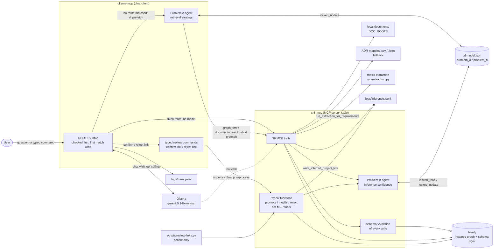
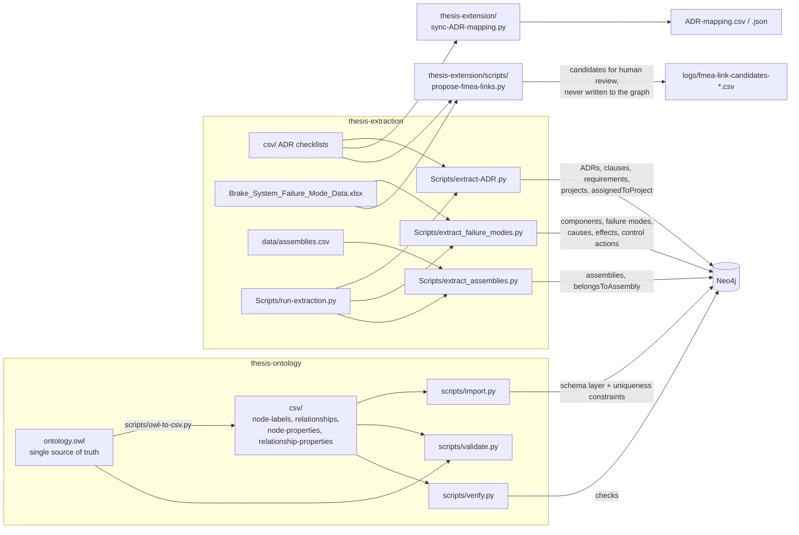
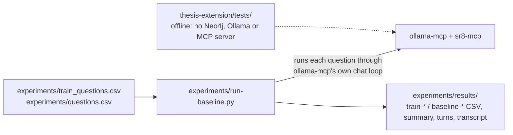

# Architecture

## Runtime: answering a question

- **Routing.** `ollama-mcp` checks its `ROUTES` table before anything else (`python3 thesis-extension/ollama-mcp --print-routes` prints it).
  - Most routes call one tool and print its raw output, without the model.
  - `manufacturing_redirect` and `design_guidance` also call the model.
  - Typed `confirm link` / `reject link` commands call the review functions directly.
  - Anything else goes to `rl_prefetch`: the Problem A agent picks a prefetch strategy for questions that name an ADR or SRP (`adr_lookup`), then the model answers with tool calls.
- **People review; the model cannot.** `promote_inferred_link`, `modify_inferred_link` and `reject_inferred_link` are plain functions in `sr8-mcp`, not MCP tools. They are reached only through `scripts/review-links.py` or the typed commands.
- **Writes are validated.** Every relationship that `write_inferred_project_link` and `write_change_impact_report` create is checked against the schema layer (`SchemaRelationship` nodes) first. If the schema is missing or the relationship type is undeclared, nothing is written.
- **Two RL problems, one file.** Both are stored in `.rl-model.json`:
  - Problem A (retrieval strategy) is written only by `ollama-mcp`.
  - Problem B (inference confidence) is written only by `sr8-mcp` and the review functions.

  Every save goes through `locked_update`, which locks the file, reloads it, applies the change and writes atomically. `sr8-mcp` reloads Problem B with `locked_read` before choosing an action and before `get_rl_policy` reports. Both processes find the file through `rl_model_path.py`.

## Build: from sources to the graph

- **Ontology.** `ontology.owl` defines 72 classes, 59 object properties and 70 data properties, plus 32 relationship properties as annotations.
  - `owl-to-csv.py` generates the four schema CSVs from it.
  - `validate.py` fails if the CSVs drift from the OWL file.
  - `import.py` loads them into Neo4j as the schema layer.
  - `verify.py` checks the import against the counts and top-level classes in the CSVs.
- **Extraction.** `run-extraction.py` runs the extractors in order: adrs, projects, parts, failure-modes, assemblies. The projects and parts steps are not implemented and are skipped. Every extractor supports `--dry-run`.
  - From the 8 ADR checklists, `extract-ADR.py` creates 217 requirements, 177 clauses and 172 `assignedToProject` links across 24 projects; 45 requirements are unassigned.
- **Supporting files.**
  - `sync-ADR-mapping.py` regenerates the ADR mapping files that `sr8-mcp` falls back to.
  - `propose-fmea-links.py` suggests FMEA-to-ADR requirement links for a person to review offline.

## Experiments and tests

- **Experiment runner.**
  - `--train --passes N` trains Problem A on the 30 training questions.
  - `--evaluate` runs the 25 evaluation questions under graph_first, documents_first, hybrid and rl, with learning off.
- **Offline tests.** Run them with `python3 -m unittest discover -s thesis-extension/tests`. They use fakes for Neo4j and the MCP client.
