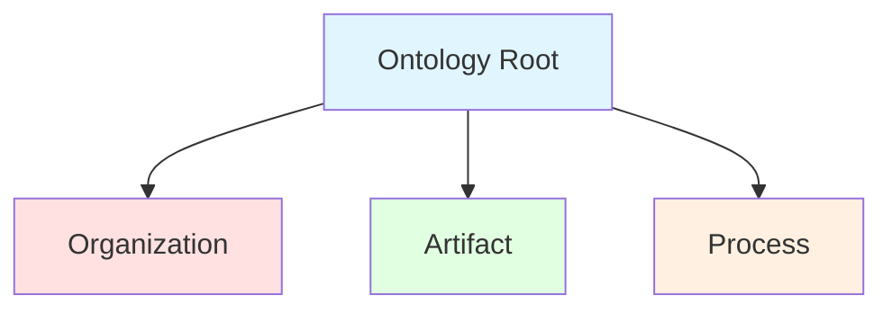
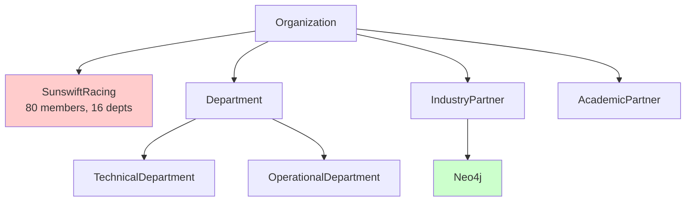
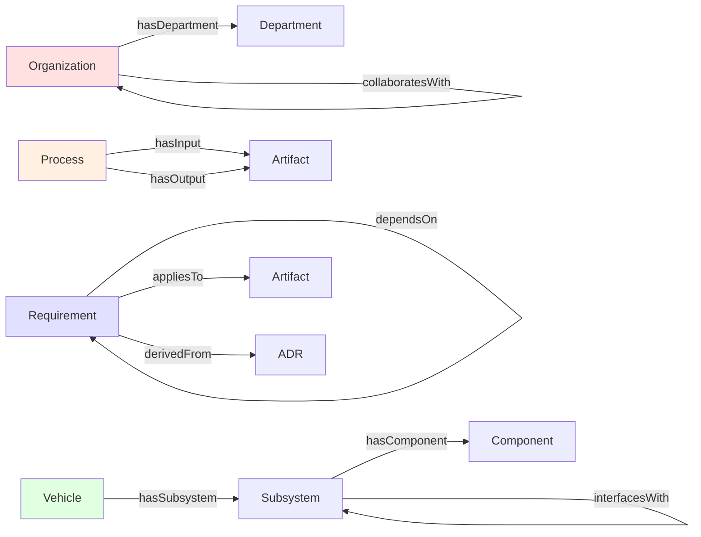
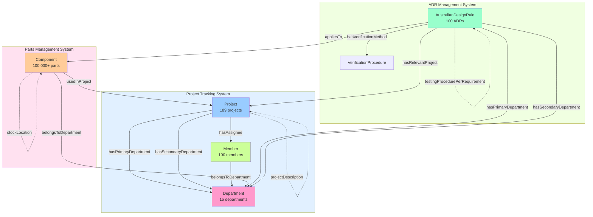
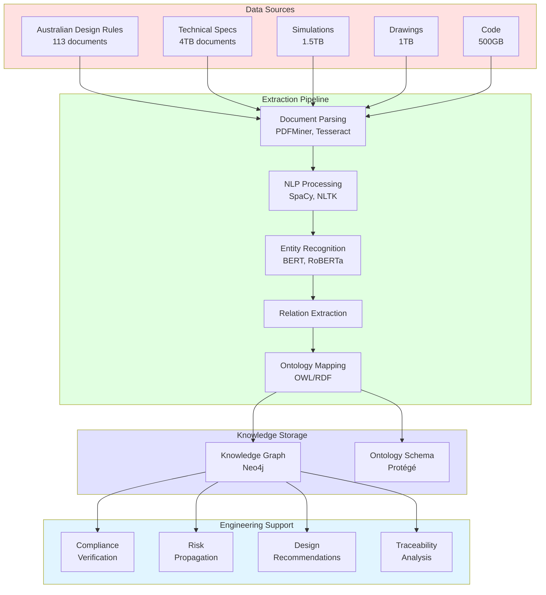
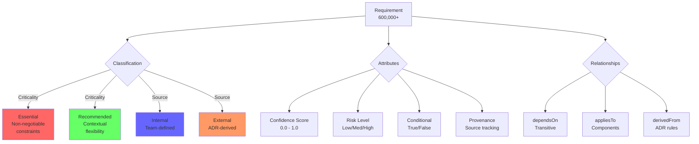
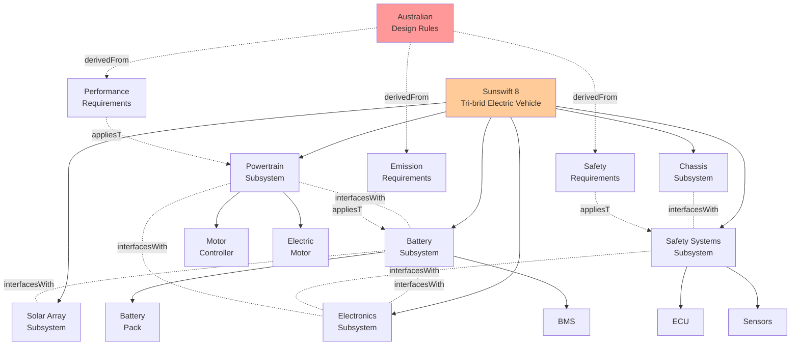
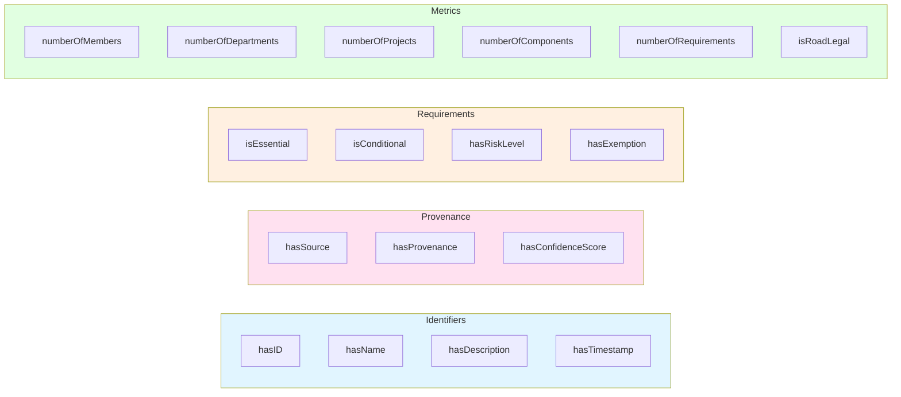
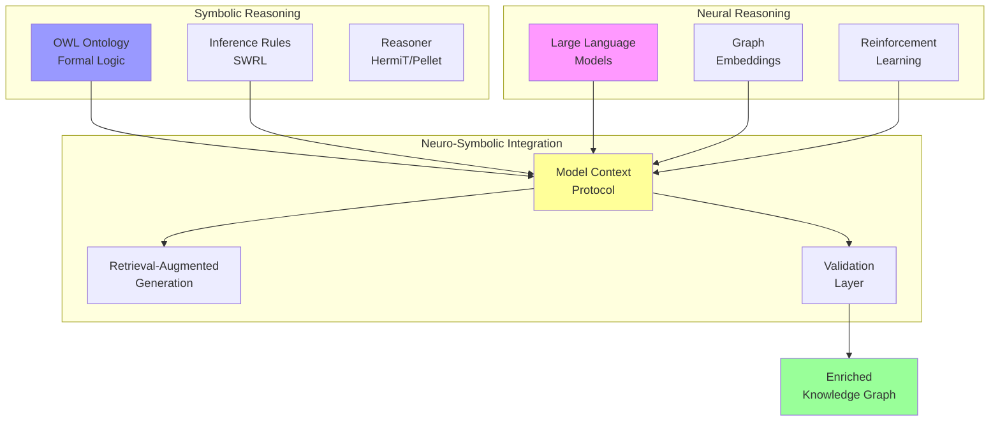

# SR8 Thesis Ontology Visual Diagrams

## 1. Complete Top-Level Class Hierarchy



## 2. Organization Hierarchy



## 3. Artifact Hierarchy (Detailed)

```mermaid
graph TD
    Art[Artifact]
    
    Art --> Veh[Vehicle]
    Art --> Doc[Document]
    Art --> Req[Requirement<br/>600,000+]
    Art --> Comp[Component<br/>100,000+]
    
    Veh --> SR8[SR8<br/>Tri-brid Electric<br/>Road Legal]
    Veh --> Sub[Subsystem]
    Veh --> Int[Interface<br/>5,000+]
    Veh --> Proj[Project<br/>189]
    
    Doc --> Reg[RegulatoryDocument]
    Doc --> Eng[EngineeringBrief]
    
    Reg --> ADR[AustralianDesignRule<br/>113 rules]
    
    Eng --> Spec[TechnicalSpecification]
    Eng --> Report[TestReport]
    Eng --> Note[DesignNote]
    Eng --> Sim[SimulationOutput<br/>1.5TB]
    Eng --> Draw[EngineeringDrawing<br/>1TB]
    
    Req --> IntR[InternalRequirement]
    Req --> ExtR[ExternalRequirement]
    Req --> VP[VerificationProcedure]
    
    IntR --> IntEss[InternalEssentialRequirement]
    IntR --> IntRec[InternalRecommendedRequirement]
    
    ExtR --> ExtEss[ExternalEssentialRequirement]
    ExtR --> ExtRec[ExternalRecommendedRequirement]
    
    IntEss --> Clause1[Clause]
    IntRec --> Clause2[Clause]
    ExtEss --> Clause3[Clause]
    ExtRec --> Clause4[Clause]
    
    VP --> VM[VerificationMethod]
    VM --> Insp[Inspection]
    VM --> Demo[Demonstration]
    VM --> Test[Test]
    VM --> Anal[Analysis]
    VM --> ADRAnn[ADRAnnex]
    VM --> ADRTest[ADRTestingProcedure]
    
    Comp --> Evid[Evidence]
    Evid --> InspEvid[InspectionEvidence]
    Evid --> DemoEvid[DemonstrationEvidence]
    Evid --> TestEvid[TestEvidence]
    Evid --> AnalEvid[AnalysisEvidence]
    Evid --> ADRAnnEvid[ADRAnnexEvidence]
    Evid --> ADRTestEvid[ADRTestingProcedureEvidence]
    
    style SR8 fill:#ffcc99
    style ADR fill:#ff9999
    style Req fill:#99ccff
    style Ess fill:#ff6666
    style Rec fill:#66ff66
```



## 4. Key Relationships (Object Properties)



## 5. Three-System Architecture



## 6. Complete Workflow Architecture



## 7. Requirement Classification System



## 8. SR8 Systems Architecture



## 9. Data Properties Overview



## 10. Ontology Usage in Neo4j

```cypher
// Example: Create SR8 vehicle node
CREATE (sr8:SR8 {
    hasID: "SR8-001",
    hasName: "Sunswift 8",
    hasDescription: "World's first road-legal student-built tri-brid electric vehicle",
    isRoadLegal: true,
    numberOfComponents: 100000,
    numberOfRequirements: 600000
})

// Example: Create ADR and requirement relationship
CREATE (adr:AustralianDesignRule {hasID: "ADR-42", hasName: "General Safety"})
CREATE (req:EssentialRequirement {
    hasID: "REQ-42-001",
    hasDescription: "Crash worthiness standards",
    isEssential: true,
    hasConfidenceScore: 0.95,
    hasRiskLevel: "High"
})
CREATE (req)-[:derivedFrom]->(adr)
CREATE (req)-[:appliesTo]->(sr8)
```

## 11. Semantic Integration



---

*These diagrams provide a comprehensive visual representation of the SR8 thesis ontology, showing the hierarchical structure, relationships, workflows, and integration points across the entire knowledge framework.*
