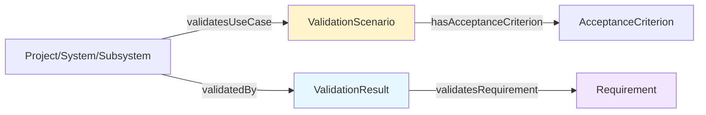
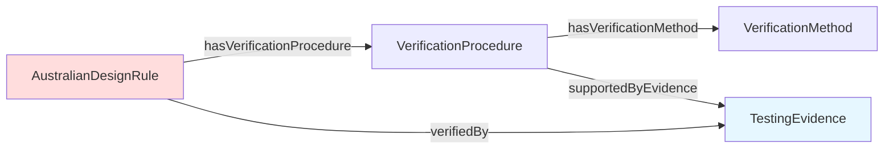
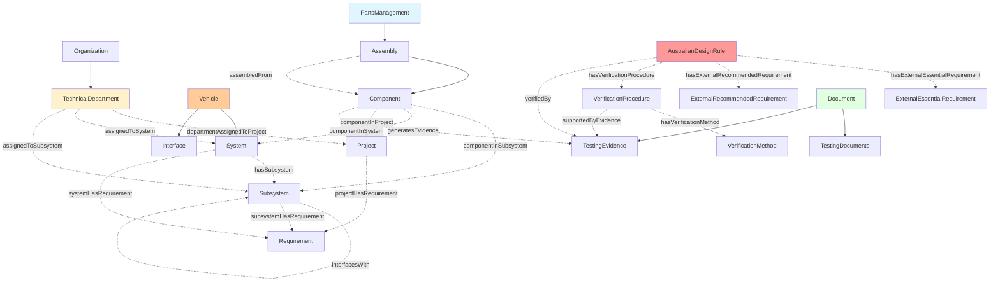
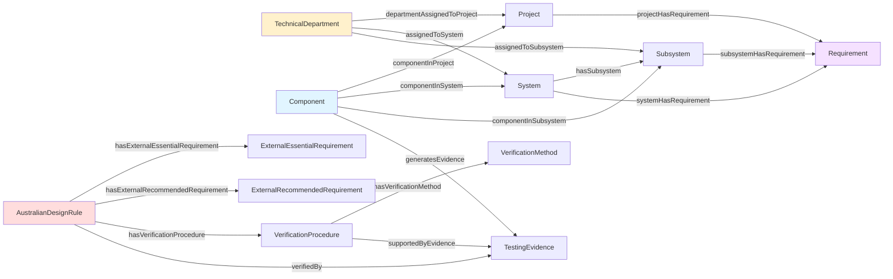

# SR8 Thesis Ontology Documentation

This ontology formally represents the knowledge domain of the Sunswift Racing SR8 tri-brid electric vehicle project, integrating regulatory compliance, knowledge graph technologies, & AI-assisted reasoning.

**Version**: 2.0
**Created**: February 26, 2026
**Authors**: Manan Rathi, Ilina Sharma

**Ontology Statistics:**
- **Classes**: 66 (Node Labels)
- **Object Properties**: 49 (Relationships)
- **Data Properties**: 50 (Attributes)
- **Total Elements**: 200+

---

## Table of Contents

1. [System Architecture](#system-architecture)
2. [Class Hierarchies](#class-hierarchies)
3. [Object Properties (Relationships)](#object-properties-relationships)
4. [Data Properties (Attributes)](#data-properties-attributes)
5. [Validation & Verification Framework](#validation--verification-framework)
6. [Visual Diagrams](#visual-diagrams)
7. [Neo4j Access](#neo4j-access)

---

## System Architecture

### Core Integration

The SR8 ontology integrates three main management systems:

```
┌─────────────────────────┐
│  Project Tracking (PTS) │
│  - 189 Projects         │
│  - 12 Technical Depts   │
│  - 100 Members          │
└───────┬─────────────────┘
        │
    │ departmentAssignedToProject
    │ assignedToSystem
    │ assignedToSubsystem
        │
┌───────▼─────────────────┐
│  Systems Engineering    │
│  - Vehicle > System     │
│  - System > Subsystem   │
│  - Requirement Flow     │
└───────┬─────────────────┘
    │ subsystemHasRequirement
    │ systemHasRequirement
    │ projectHasRequirement
    │
┌───────▼─────────────────┐         ┌──────────────────────┐
│  ADR Management         │◄────────┤  Parts Management    │
│  - 100 ADRs             │         │  - 100,000+ Parts    │
│  - Verification         │         │  - Assembly/Component│
│  - External Req Links   │         │  - componentIn* links│
└─────────────────────────┘         └──────────────────────┘
    │                                      │
    │ hasExternalEssentialRequirement      │ componentInSubsystem
    │ hasExternalRecommendedRequirement    │ componentInSystem
    │ verifiedBy / supportedByEvidence     │ componentInProject
    └──────────────────────────────────────┘
```

### 1. Project Tracking System (PTS)

**Projects** (189 total) - Single nodes with properties:
- `projectID` - Unique project identifier
- `projectName` - Name of the project
- `projectDescription` - Description of the project

**Departments** (12 technical departments + operational units) - Organizational units:
- `TechnicalDepartment` - Technical departments
- `OperationalDepartment` - Operational departments
- Properties: `hasID`, `hasName`, `sectionName`

Technical departments:
- `ChassisAndBodywork`
- `Interior`
- `Powertrain`
- `VehicleDynamics`
- `EnergySystems`
- `EmbeddedSystems`
- `TechnicalSupportSystems`
- `IndustrialDesign`
- `WholeTeam`
- `RemoteDriving`
- `General`
- `AlternativeEnergies`

**Members** (100 total) - Project assignees:
- `hasID` - Member identifier
- `hasName` - Member name

**Relationships**:
- `hasPrimaryDepartment` → Department
- `hasSecondaryDepartment` → Department
- `hasAssignee` → Member
- `belongsToDepartment` → Department (for members)

### 2. Parts Management System

**Component** (100,000+ parts) - Engineering parts & assemblies with properties:

*Identification*
- `partNumber` - Unique part identifier
- `partDescription` - Component description
- `bomLevel` - BOM hierarchy level
- `onCarSoftwareOffCar` - Classification type

*Physical Properties*
- `quantityPer` - Quantity per assembly
- `estimatedWeight` - Estimated weight (kg)
- `actualWeight` - Actual weight (kg)

*Status*
- `approvalStatus` - Component approval status
- `componentStatus` - Current status

*Supply Chain*
- `procurementStatus` - Procurement status
- `supplier` - Supplier name
- `orderStatus` - Order status
- `stockQuantity` - Stock quantity
- `stockLocation` - Stock location

*Cost Tracking*
- `assemblyEstimatedCost` - Estimated cost
- `assemblyActualCost` - Actual cost

*ADR Integration*
- `relatedADRs` - Related ADR identifiers
- `engineeringDrawingRequired` - Engineering drawing flag (boolean)

**Relationships**:
- `usedInProject` → Project
- `belongsToDepartment` → Department
- `usedInADR` → AustralianDesignRule
- `generatesEvidence` → TestingEvidence
- `suppliedBy` → IndustryPartner
- `partOfBOM` → Component (BOM hierarchy)

### 3. ADR Management System

**AustralianDesignRule** (100 total) - Regulatory requirements with properties:

*Identification*
- `hasID` - ADR identifier (e.g., "ADR-042")
- `hasName` - ADR name
- `requirementName` - Requirement title
- `requirementText` - Full requirement text
- `requirementDescription` - Detailed description

*Verification*
- `verificationMethodDescription` - Verification details
- `testingProcedurePerRequirement` - Testing procedure
- `isVerified` - Verification status (boolean)
- `usesAlternativeTesting` - Alternative testing flag (boolean)
- `rightProjectAssigned` - Correct project flag (boolean)
- `alternativeProjectSuggestion` - Suggested alternative project

*Risk & Classification*
- `hasRiskLevel` - Risk categorization
- `hasExemption` - ADR exemption details
- `isEssential` - Essential vs recommended (boolean)
- `isConditional` - Conditional applicability (boolean)

**Related Nodes**:
- `Clause` - Specific clause reference (each clause is a new node connected to 1 ADR)

**Verification Methods** (6 types):
1. `Inspection` - Visual or manual inspection
2. `Demonstration` - Functional demonstration
3. `Test` - Physical or functional testing
4. `Analysis` - Simulations & calculations
5. `ADRAnnex` - ADR annex procedures
6. `ADRTestingProcedure` - Official ADR testing

**Evidence Types** (6 types, formed when components collectively pass testing procedures):
1. `InspectionEvidence` - Visual/manual inspection results
2. `DemonstrationEvidence` - Demonstration results
3. `TestEvidence` - Physical/functional testing results
4. `AnalysisEvidence` - Simulation/calculation results
5. `ADRAnnexEvidence` - ADR annex procedure results
6. `ADRTestingProcedureEvidence` - Official ADR testing results

**Relationships**:
- `hasClause` → Clause
- `assignedToProject` → Project
- `assignedToDepartment` → Department
- `hasRelevantProject` → Project
- `hasRelevantDepartment` → Department
- `hasVerificationProcedure` → VerificationProcedure
- `hasVerificationMethod` → VerificationMethod
- `supportedByEvidence` → TestingEvidence
- `verifiedBy` → TestingEvidence

### Key Metrics

| System | Entities | Key Features |
|--------|----------|--------------|
| Project Tracking | 189 Projects, 12 Technical Departments, 100 Members | Primary/secondary departments, member assignments |
| Parts Management | 100,000+ Components | BOM hierarchy, supply chain, cost tracking |
| ADR Management | 100 ADRs | 6 verification methods, evidence tracking |

---

## Class Hierarchies

### 1. Organization Hierarchy

```
Organization
├── Department
│   ├── TechnicalDepartment
│   │   ├── ChassisAndBodywork
│   │   ├── Interior
│   │   ├── Powertrain
│   │   ├── VehicleDynamics
│   │   ├── EnergySystems
│   │   ├── EmbeddedSystems
│   │   ├── TechnicalSupportSystems
│   │   ├── IndustrialDesign
│   │   ├── WholeTeam
│   │   ├── General
│   │   ├── RemoteDriving
│   │   └── AlternativeEnergies
│   └── OperationalDepartment
├── IndustryPartner
└── AcademicPartner
```

**Key Relationships**:
- `hasDepartment` - Organization → Department
- `collaboratesWith` - Organization ↔ Organization (symmetric)
- `hasSection` - Department → Department (organizational hierarchy)

### 2. Engineering Hierarchy

```
Vehicle
├── System
│   └── Subsystem
├── Interface
└── Project

Document
│   ├── RegulatoryDocument
│   │   └── AustralianDesignRule (ADR)
│   │       ├── ExternalEssentialRequirement
│   │       └── ExternalRecommendedRequirement
│   ├── EngineeringBrief
│   ├── TestingDocuments
│   │   ├── TechnicalSpecification
│   │   ├── TestReport
│   │   ├── DesignNote
│   │   ├── SimulationOutput
│   │   └── EngineeringDrawing
│   ├── TestingEvidence
│   │   ├── InspectionEvidence
│   │   ├── DemonstrationEvidence
│   │   ├── TestEvidence
│   │   ├── AnalysisEvidence
│   │   ├── ADRAnnexEvidence
│   │   └── ADRTestingProcedureEvidence
│   ├── ConceptualDesign
│   ├── PreliminaryDesign
│   └── DetailedDesign

Requirement
│   ├── InternalRequirement
│   │   ├── InternalEssentialRequirement
│   │   │   └── Clause
│   │   └── InternalRecommendedRequirement
│   │       └── Clause
│   ├── ExternalRequirement
│   │   ├── ExternalEssentialRequirement
│   │   │   └── Clause
│   │   └── ExternalRecommendedRequirement
│   │       └── Clause
│   ├── ValidationScenario
│   │   └── AcceptanceCriterion
│   ├── ValidationResult
│   └── VerificationProcedure
│       └── VerificationMethod
│           ├── Inspection
│           ├── Demonstration
│           ├── Test
│           ├── Analysis
│           ├── ADRAnnex
│           └── ADRTestingProcedure

PartsManagement
└── Assembly
    └── Component
```

---

## Object Properties (Relationships)

### Organizational Relationships
- `hasDepartment` - Organization → Department
- `collaboratesWith` - Organization ↔ Organization (symmetric)
- `hasSection` - Department → Department
- `assignedToSystem` - TechnicalDepartment → System
- `assignedToSubsystem` - TechnicalDepartment → Subsystem
- `departmentAssignedToProject` - TechnicalDepartment → Project

### Engineering Relationships
- `hasRequirement` - All → Requirement
- `subsystemHasRequirement` - Subsystem → Requirement
- `systemHasRequirement` - System → Requirement
- `projectHasRequirement` - Project → Requirement
- `validatesUseCase` - All → ValidationScenario
- `hasAcceptanceCriterion` - ValidationScenario → AcceptanceCriterion
- `validatedBy` - All → ValidationResult
- `validatesRequirement` - ValidationResult → Requirement
- `hasComponent` - Subsystem → Component (transitive)
- `componentInSubsystem` - Component → Subsystem
- `componentInSystem` - Component → System
- `componentInProject` - Component → Project
- `assembledFrom` - Assembly → Component
- `hasSubsystem` - System → Subsystem
- `interfacesWith` - Subsystem ↔ Subsystem (symmetric)
- `dependsOn` - Requirement → Requirement (transitive)
- `impactsOn` - Requirement → Requirement
- `appliesTo` - Requirement → All
- `derivedFrom` - Requirement → AustralianDesignRule
- `documentedIn` - All → Document

### ADR Verification Relationships
- `assignedToProject` - AustralianDesignRule → Project
- `assignedToDepartment` - AustralianDesignRule → Department
- `hasRelevantProject` - AustralianDesignRule → Project
- `hasRelevantDepartment` - AustralianDesignRule → Department
- `hasVerificationProcedure` - AustralianDesignRule → VerificationProcedure
- `hasVerificationMethod` - VerificationProcedure → VerificationMethod
- `supportedByEvidence` - VerificationProcedure → TestingEvidence
- `verifiedBy` - AustralianDesignRule → TestingEvidence
- `hasClause` - AustralianDesignRule → Clause
- `hasExternalEssentialRequirement` - AustralianDesignRule → ExternalEssentialRequirement
- `hasExternalRecommendedRequirement` - AustralianDesignRule → ExternalRecommendedRequirement

### Component Management Relationships
- `usedInProject` - Component → Project
- `usedInADR` - Component → AustralianDesignRule
- `generatesEvidence` - Component → TestingEvidence
- `suppliedBy` - Component → IndustryPartner
- `partOfBOM` - Component → Component (BOM hierarchy)
- `belongsToDepartment` - Component → Department

### Project Tracking Relationships
- `hasPrimaryDepartment` - Project → Department
- `hasSecondaryDepartment` - Project → Department
- `hasAssignee` - Project → Member

### Compliance & Risk Relationships
- `compliesWith` - All → AustralianDesignRule
- `hasRisk` - All → Requirement
- `propagatesRiskTo` - Subsystem → Subsystem

### Property Characteristics
- **Symmetric**: `interfacesWith`, `collaboratesWith`
- **Transitive**: `dependsOn`, `hasComponent`

---

## Validation & Verification Framework

### Distinction
- **Verification** answers: Are we building the system right?
- **Validation** answers: Are we building the right system for intended use?

### Validation Flow



### Verification Flow



---

## Data Properties (Attributes)

### Identifiers & Metadata
- `hasID` (string) - Unique identifier
- `hasName` (string) - Entity name
- `hasDescription` (string) - Detailed description
- `hasTimestamp` (dateTime) - Temporal metadata

### Provenance & Confidence
- `hasSource` (string) - Data source
- `hasProvenance` (string) - Origin & history
- `hasConfidenceScore` (float, 0-1) - Extraction confidence

### Requirement Attributes
- `isEssential` (boolean) - Essential vs recommended
- `isConditional` (boolean) - Conditional applicability
- `hasRiskLevel` (string) - Risk categorization (Low/Medium/High/Critical)
- `hasExemption` (string) - ADR exemption details

### ADR Tracking Attributes
- `requirementName` (string) - Requirement title
- `requirementText` (string) - Full requirement text
- `requirementDescription` (string) - Detailed description
- `isVerified` (boolean) - Verification status
- `usesAlternativeTesting` (boolean) - Alternative testing flag
- `verificationMethodDescription` (string) - Verification details
- `testingProcedurePerRequirement` (string) - Testing procedure
- `rightProjectAssigned` (boolean) - Correct project flag
- `alternativeProjectSuggestion` (string) - Suggested alternative project

### Component Management Attributes

*Identification*
- `partNumber` (string) - Unique part identifier
- `partDescription` (string) - Component description
- `bomLevel` (integer) - BOM hierarchy level
- `approvalStatus` (string) - Approval status
- `componentStatus` (string) - Current status
- `onCarSoftwareOffCar` (string) - Classification type

*Physical Properties*
- `quantityPer` (integer) - Quantity per assembly
- `estimatedWeight` (float) - Estimated weight (kg)
- `actualWeight` (float) - Actual weight (kg)

*Supply Chain*
- `procurementStatus` (string) - Procurement status
- `supplier` (string) - Supplier name
- `orderStatus` (string) - Order status
- `stockQuantity` (integer) - Stock quantity
- `stockLocation` (string) - Stock location

*Cost & Engineering*
- `assemblyEstimatedCost` (float) - Estimated cost
- `assemblyActualCost` (float) - Actual cost
- `relatedADRs` (string) - Related ADR identifiers
- `engineeringDrawingRequired` (boolean) - Engineering drawing flag

*Project Properties*
- `projectID` (string) - Project identifier
- `projectName` (string) - Project name
- `projectDescription` (string) - Project description

*Department Properties*
- `sectionName` (string) - Department section name

### Quantitative Metrics
- `numberOfMembers` (integer) - Team size
- `numberOfDepartments` (integer) - Organizational units
- `numberOfProjects` (integer) - Concurrent projects
- `numberOfComponents` (integer) - Component count
- `numberOfRequirements` (integer) - Requirement count
- `isRoadLegal` (boolean) - Legal status

### Axioms & Constraints

**Disjoint Classes**:
- `EssentialRequirement` ⊥ `RecommendedRequirement`
- `InternalRequirement` ⊥ `ExternalRequirement`

---

## Visual Diagrams

### Complete Workflow Architecture


### Engineering Systems Architecture



### Relationship Matrix (Consolidated)



---

## neo4j Access

### Start neo4j

```bash
brew services start neo4j
```

### Open neo4j Browser

```bash
open http://localhost:7474
```

### Login Credentials

- **Connect URL**: `bolt://localhost:7687`
- **Username**: `neo4j`
- **Password**: `password123`

### Quick Queries

See [cypher.md](cypher.md) for comprehensive query examples including:
- Schema validation
- Component tracking
- ADR verification
- Traceability analysis
- Cost & weight analysis
- Supply chain queries

---

*This ontology provides complete traceability across Projects, Components, & Regulatory Compliance for the SR8 tri-brid electric vehicle project.*