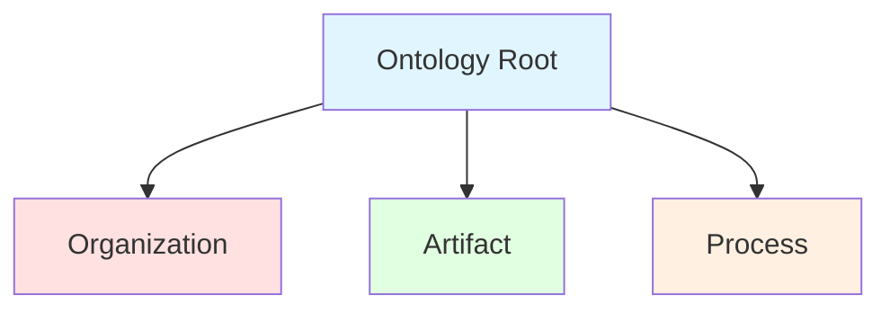
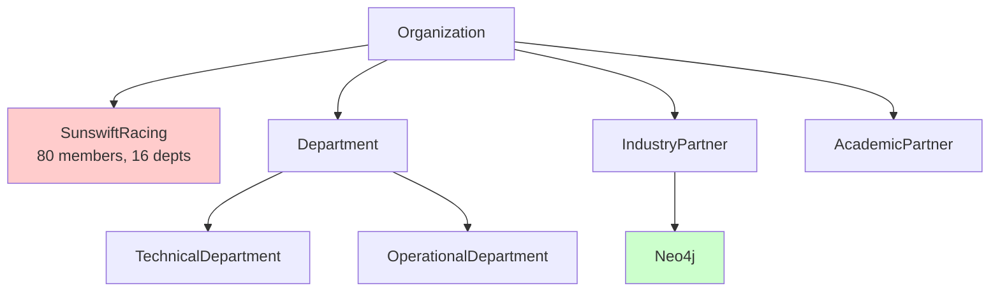
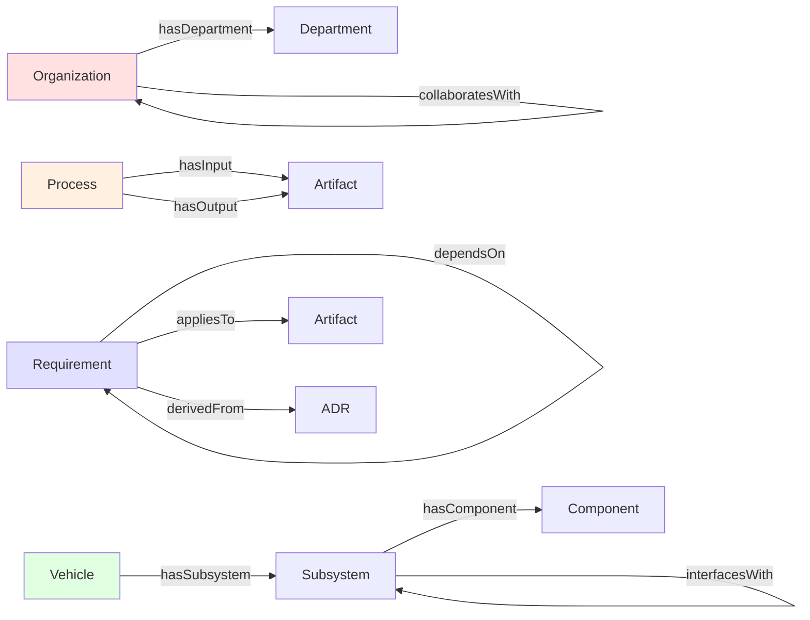
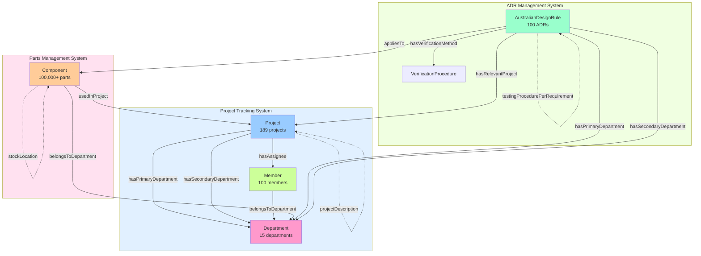
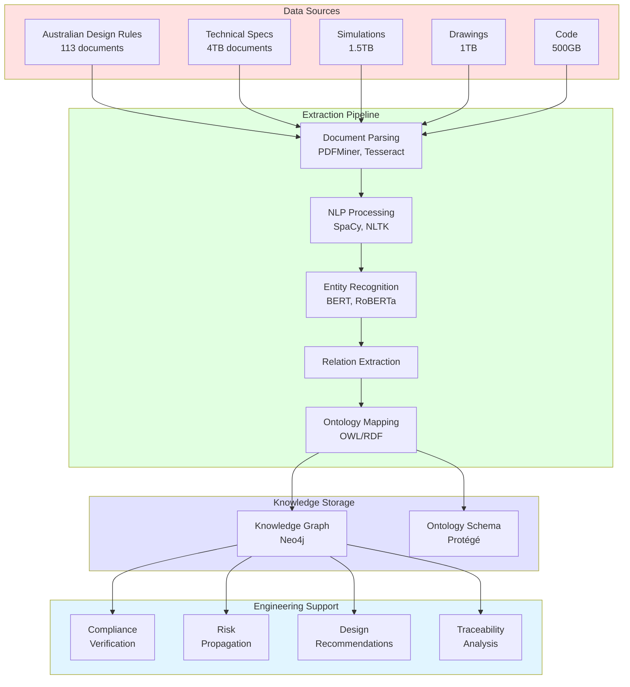
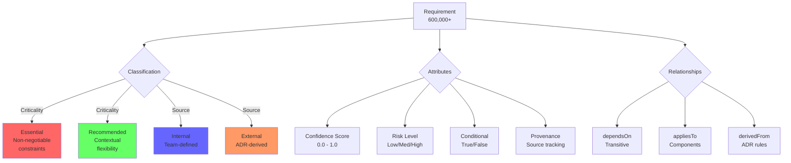
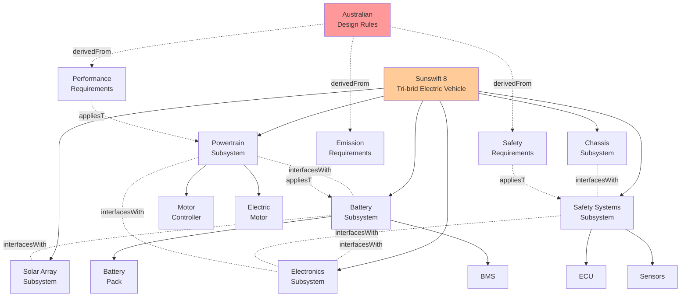
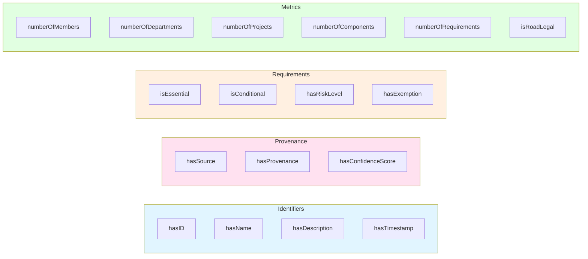
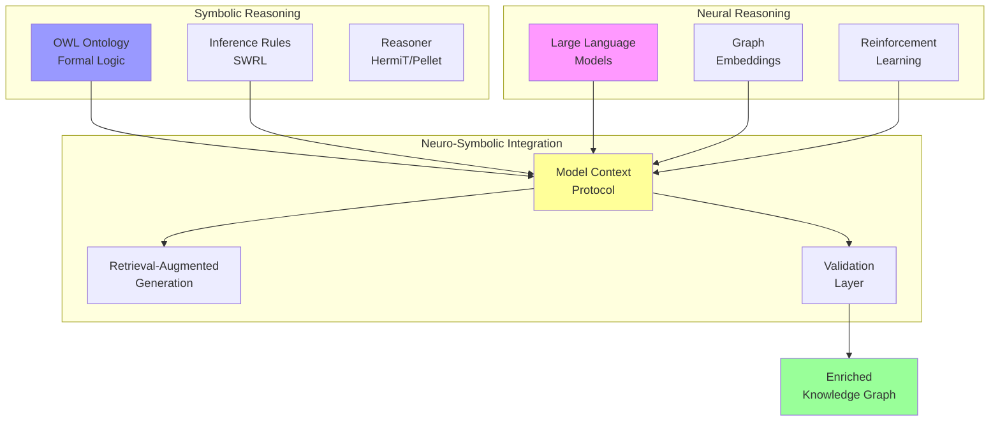

# SR8 Thesis Ontology - Neo4j Database

## Overview

This repository contains a comprehensive OWL/RDF ontology for the Sunswift Racing SR8 tri-brid electric vehicle project, structured around three integrated management systems.

**Ontology Statistics:**
- 48 classes (node labels) including Member class
- 37 object properties (relationships)
- 56 data properties (attributes)
- 185+ total semantic elements

## Quick Start

## Accessing Neo4j Browser

### Start neo4j

```bash
brew services start neo4j
```

### Open neo4j Browser

Open your browser and navigate to:
```
http://localhost:7474
```

Or run:
```bash
open http://localhost:7474
```

### Login Credentials

- **Connect URL:** `bolt://localhost:7687`
- **Username:** `neo4j`
- **Password:** `password123`

## Key Features

✅ **Project Tracking System** - 189 projects with primary/secondary departments and 100 member assignees  
✅ **ADR Management** - Track 100 Australian Design Rules with 4 verification types (Inspection, Demonstration, Test, Analysis)  
✅ **Component Management** - Full BOM hierarchy with part-to-project-to-ADR traceability  
✅ **Verification Evidence** - 6 evidence types aligned with verification methods (Inspection, Demonstration, Test, Analysis, ADR Annex, ADR Testing Procedure)  
✅ **Multi-System Integration** - Seamless connections between Projects, Parts, and ADRs  
✅ **Supply Chain** - Supplier, procurement, and inventory management

## Core Systems

### 1. Project Tracking System (189 Projects)
- **Projects**: projectID, projectName, projectDescription
- **Departments** (15): Primary and Secondary assignments
- **Members** (100): Project assignees/owners
- **Relationships**: hasPrimaryDepartment, hasSecondaryDepartment, hasAssignee

### 2. Parts Management System
- **Components**: partNumber, partDescription, bomLevel
- **BOM Hierarchy**: Multi-level assembly structure
- **Project Linkage**: usedInProject relationship
- **ADR Compliance**: relatedADRs, usedInADR
- **Supply Chain**: suppliedBy → IndustryPartner

### 3. ADR Management System (100 ADRs)
- **ADR Related Nodes**: Clause (each clause is a new node connected to 1 ADR)
- **ADR Properties**: requirementName, requirementDescription
- **Verification Methods**: Inspection, Demonstration, Test, Analysis (Simulations/Calculations)
- **Testing Procedures**: testingProcedurePerRequirement
- **Project/Department Links**: assignedToProject, hasRelevantProject, hasRelevantDepartment
- **Evidence Tracking**: verifiedBy → InspectionEvidence, DemonstrationEvidence, TestEvidence, AnalysisEvidence, ADRAnnexEvidence, ADRTestingProcedureEvidence

## Quick Start Queries

### 1. View All Components by Project

```cypher
MATCH (c:Component)-[:usedInProject]->(p:Project)
RETURN p.hasName AS Project,
       COUNT(c) AS Components,
       SUM(c.actualWeight) AS Total_Weight_kg
ORDER BY Components DESC;
```

### 2. ADR Verification Status

```cypher
MATCH (adr:AustralianDesignRule)
RETURN adr.isVerified AS Verified,
       COUNT(adr) AS Count
ORDER BY Verified DESC;
```

### 3. Component Life-Cycle Progress

```cypher
MATCH (c:Component)
RETURN 
    SUM(CASE WHEN c.usedInCarBuild THEN 1 ELSE 0 END) AS Car_Build_Ready,
    SUM(CASE WHEN c.usedInTrackTest01 THEN 1 ELSE 0 END) AS Track_Test_Ready,
    SUM(CASE WHEN c.usedInRoadTest01 THEN 1 ELSE 0 END) AS Road_Test_Ready;
```

### 2. View Complete Ontology Structure

```cypher
MATCH (n:SchemaLabel)-[r:SUBCLASS_OF*]->(root)
WHERE root.type = 'TopLevel'
RETURN n, r, root
LIMIT 100
```

### 3. Explore Artifact Hierarchy

```cypher
MATCH path = (:SchemaLabel {name: 'Artifact'})<-[:SUBCLASS_OF*]-(child)
RETURN path
```

### 4. View All Relationship Types

```cypher
MATCH (r:SchemaRelationship)
RETURN r.name, r.sourceLabel, r.targetLabel, r.description
```

### 5. Count Classes By Category

```cypher
MATCH (n:SchemaLabel)
RETURN n.category as Category, count(*) as Count
ORDER BY Count DESC
```

### 5. View Requirements-Related Relationships

```cypher
MATCH (r:SchemaRelationship)
WHERE r.sourceLabel = 'Requirement' OR r.targetLabel = 'Requirement'
RETURN r.name, r.sourceLabel, r.targetLabel
```

## Command Line Access

### Using cypher-shell

```bash
# View Top-Level Categories
cypher-shell -u neo4j -p password123 \
  "MATCH (n:SchemaLabel) WHERE n.type = 'TopLevel' RETURN n.name, n.description;"

# Count All Nodes
cypher-shell -u neo4j -p password123 \
  "MATCH (n:SchemaLabel) RETURN n.category, count(*) ORDER BY count(*) DESC;"

# View All Relationships
cypher-shell -u neo4j -p password123 \
  "MATCH (r:SchemaRelationship) RETURN r.name LIMIT 10;"
```

## Workflow Summary

```
DATA SOURCES
    ↓
KNOWLEDGE EXTRACTION
    • Document parsing (PDFMiner, Tesseract)
    • NLP processing (SpaCy, NLTK)
    • Entity recognition (BERT, RoBERTa)
    • Relation extraction
    • Ontology mapping (OWL/RDF)
    ↓
KNOWLEDGE GRAPH (Neo4j)
    • Structured entities
    • Semantic relationships
    • Ontology-aligned schema
    ↓
DATA VALIDATION
    • Consistency checking
    • Relationship verification
    • Completeness validation
    ↓
ENGINEERING SUPPORT
    • Compliance verification
    • Risk propagation
    • Design recommendations
    • Traceability analysis
```

---

## Usage Scenarios

### Scenario 1: Finding Requirements for a Component

**Question**: What ADR requirements apply to the Battery Management System?

**Cypher Query**:
```cypher
MATCH (bms:Component {hasName: "Battery Management System"})
      -[:appliesTo]-(req:Requirement)
      -[:derivedFrom]->(adr:AustralianDesignRule)
RETURN bms.hasName, req.hasDescription, adr.hasName
```

### Scenario 2: Tracing Risk Propagation

**Question**: What subsystems are affected if the battery has a thermal risk?

**Cypher Query**:
```cypher
MATCH (battery:Subsystem {hasName: "Battery Subsystem"})
      -[:propagatesRiskTo*1..3]->(affected:Subsystem)
RETURN affected.hasName, affected.hasRiskLevel
ORDER BY affected.hasRiskLevel DESC
```

### Scenario 3: Finding Cross-Department Interfaces

**Question**: What interfaces exist between Powertrain and Electronics departments?

**Cypher Query**:
```cypher
MATCH (d1:Department {hasName: "Powertrain"})-[:owns]->(s1:Subsystem)
      -[:interfacesWith]-(s2:Subsystem)<-[:owns]-(d2:Department {hasName: "Electronics"})
RETURN s1.hasName, s2.hasName
```

### Scenario 5: Compliance Gap Analysis

**Question**: Which components don't comply with their applicable ADRs?

**Cypher Query**:
```cypher
MATCH (c:Component)-[:appliesTo]-(req:Requirement)
      -[:derivedFrom]->(adr:AustralianDesignRule)
WHERE NOT (c)-[:compliesWith]->(adr)
RETURN c.hasName, adr.hasName, req.hasDescription
```

## Extend the Ontology

### Add a New Class
```xml
<owl:Class rdf:about="#NewSubsystem">
    <rdfs:subClassOf rdf:resource="#Subsystem"/>
    <rdfs:label>New Subsystem Type</rdfs:label>
    <rdfs:comment>Description of new subsystem</rdfs:comment>
</owl:Class>
```

### Add a New Relationship
```xml
<owl:ObjectProperty rdf:about="#newRelationship">
    <rdfs:domain rdf:resource="#SourceClass"/>
    <rdfs:range rdf:resource="#TargetClass"/>
    <rdfs:label>new relationship</rdfs:label>
</owl:ObjectProperty>
```

### Add a New Individual
```xml
<owl:NamedIndividual rdf:about="#NewInstance">
    <rdf:type rdf:resource="#ClassName"/>
    <hasName>Instance Name</hasName>
    <hasDescription>Instance description</hasDescription>
</owl:NamedIndividual>
```

---

# Three-System Alignment

## 1. Project Tracking System (PTS)

### Projects (189 Projects) - All as Single Nodes

**Class**: `Project`

**Properties**:
- `projectName` - Name of the project
- `projectID` - Unique project identifier
- `projectDescription` - Description of the project

**Relationships**:
- `hasPrimaryDepartment` → Department - Primary responsible department
- `hasSecondaryDepartment` → Department - Secondary supporting department
- `hasAssignee` → Member - Project assignee/owner

### Departments (15 Departments) - All as Single Nodes

**Class**: `Department`

**Subclasses**:
- `TechnicalDepartment` - Technical departments
- `OperationalDepartment` - Operational departments

**Properties**:
- `hasID` - Department identifier
- `hasName` - Department name

### Project Assignee (100 Members) - All as Single Nodes

**Class**: `Member`

**Properties**:
- `hasID` - Member identifier
- `hasName` - Member name

**Relationships**:
- Project → Member via `hasAssignee`

---

## 2. Parts Management System

### Component/Part Management

**Class**: `Component`

**Properties**:
- `partNumber` - Unique part number identifier
- `partDescription` - Description of the component/part
- `bomLevel` - Bill of Materials hierarchy level
- `approvalStatus` - Component approval status
- `componentStatus` - Current status
- `quantityPer` - Quantity per assembly
- `estimatedWeight` - Estimated weight (kg)
- `actualWeight` - Actual weight (kg)
- `procurementStatus` - Procurement status
- `supplier` - Supplier name
- `orderStatus` - Order status
- `stockQuantity` - Stock quantity
- `stockLocation` - Stock location
- `relatedADRs` - Related ADR identifiers
- `componentProjectName` - Name of the project using this component
- `clause` - ADR clause reference for this component

**Relationships**:
- `usedInProject` → Project - Project that uses this component
- `belongsToDepartment` → Department - Responsible department
- `usedInADR` → AustralianDesignRule - ADRs this component relates to
- `generatesEvidence` → Evidence - Evidence generated by this component
- `suppliedBy` → IndustryPartner - Procurement partner/supplier
- `partOfBOM` → Component - BOM hierarchy (component assemblies)

---

## 3. ADR Management System

### ADRs (100 ADRs) - All as Single Nodes

**Class**: `AustralianDesignRule`

**Properties**:

#### Basic Information
- `hasID` - ADR identifier (e.g., "ADR-42")
- `hasName` - ADR name
- `requirementText` - Full requirement text
- `requirementName` - Name or title of requirement
- `requirementDescription` - Detailed description of requirement

#### ADR Related Nodes (Connected via Relationships)
- Uses `hasClause` relationship → Clause node - Specific clause reference (each clause is a new node connected to 1 ADR)

#### Project Connection (Connected to PTS)
- Uses `hasRelevantProject` relationship to link to Project node
- Uses `hasPrimaryDepartment` and `hasSecondaryDepartment` relationships to link to Departments

#### Verification Information
- `verificationMethodDescription` - Detailed verification description
- `testingProcedurePerRequirement` - Testing procedure per requirement
- `isVerified` - Verification status (boolean)
- `usesAlternativeTesting` - Alternative testing method flag (boolean)

#### Other Attributes
- `hasRiskLevel` - Risk categorization
- `hasExemption` - ADR exemption details
- `isEssential` - Essential vs. recommended (boolean)
- `isConditional` - Conditional applicability (boolean)

**Relationships**:

#### ADR Related Nodes
- `hasClause` → Clause - Specific clause reference within ADR (each clause is a new node connected to 1 ADR)

#### Project & Department Connections
- `assignedToProject` → Project - Project assigned to handle this ADR
- `assignedToDepartment` → Department - Department assigned to this ADR
- `hasRelevantProject` → Project - Relevant projects for this ADR
- `hasRelevantDepartment` → Department - Relevant departments for this ADR

#### Verification Method (4 Types)
- `hasVerificationMethod` → VerificationMethod
  - `Inspection`
  - `Demonstration`
  - `Test`
  - `Analysis` (Simulations/Calculations)

#### Verification Procedure
- `hasVerificationProcedure` → VerificationProcedure
  - Links to detailed procedures
  - `hasVerificationMethod` → VerificationMethod
  - `supportedByEvidence` → Evidence

#### Evidence
- `verifiedBy` → Evidence
  - `SimulationEvidence`
  - `MathematicalEvidence`
  - `TestEvidence`

#### Requirements & Artifacts
- `derivedFrom` (inverse) → Requirement - Requirements derived from this ADR
- `appliesTo` (via Requirement) → Artifact - Artifacts this ADR applies to
- `compliesWith` (inverse) → Artifact - Artifacts that comply with this ADR

---

## System Integration

### Data Flow Between Systems

```
┌─────────────────────────┐
│  Project Tracking (PTS) │
│  - 189 Projects         │
│  - 15 Departments       │
│  - 100 Members          │
└───────┬─────────────────┘
        │
        │ assignedToProject
        │ hasRelevantProject
        │ hasPrimaryDepartment
        │
┌───────▼─────────────────┐         ┌──────────────────────┐
│  ADR Management         │◄────────┤  Parts Management    │
│  - 100 ADRs             │         │  - Components        │
│  - 4 Verification Types │         │  - BOM Hierarchy     │
│  - Evidence             │         │                      │
└─────────────────────────┘         └──────────────────────┘
        │                                      │
        │ usedInADR                            │
        │ relatedADRs                          │
        └──────────────────────────────────────┘
```

### Key Metrics

| System | Nodes | Key Relationships |
|--------|-------|-------------------|
| Project Tracking | 189 Projects, 15 Departments, 100 Members | hasPrimaryDepartment, hasSecondaryDepartment, hasAssignee |
| Parts Management | Components (varies) | usedInProject, usedInADR, suppliedBy, partOfBOM |
| ADR Management | 100 ADRs | assignedToProject, hasRelevantProject, hasVerificationMethod |

---

## Query Examples

### 1. Find All Projects with Their Departments
```cypher
MATCH (p:Project)
OPTIONAL MATCH (p)-[:hasPrimaryDepartment]->(primary:Department)
OPTIONAL MATCH (p)-[:hasSecondaryDepartment]->(secondary:Department)
OPTIONAL MATCH (p)-[:hasAssignee]->(m:Member)
RETURN p.projectID, p.projectName, 
       primary.hasName AS PrimaryDept,
       secondary.hasName AS SecondaryDept,
       m.hasName AS Assignee;
```

### 2. Find ADRs and Their Verification Methods
```cypher
MATCH (adr:AustralianDesignRule)
OPTIONAL MATCH (adr)-[:hasVerificationMethod]->(vm:VerificationMethod)
OPTIONAL MATCH (adr)-[:assignedToProject]->(p:Project)
OPTIONAL MATCH (adr)-[:hasRelevantDepartment]->(d:Department)
OPTIONAL MATCH (adr)-[:hasClause]->(clause:Clause)
RETURN adr.hasID, 
       adr.requirementName AS RequirementName,
       clause.hasName AS Clause,
       vm.hasName AS VerificationMethod,
       p.projectID AS AssignedProject,
       collect(DISTINCT d.hasName) AS RelevantDepartments;
```

### 3. Find Components by Project and ADR
```cypher
MATCH (c:Component)-[:usedInProject]->(p:Project)
OPTIONAL MATCH (c)-[:usedInADR]->(adr:AustralianDesignRule)
OPTIONAL MATCH (c)-[:suppliedBy]->(supplier:IndustryPartner)
RETURN p.projectID, 
       c.partNumber, 
       c.partDescription,
       c.bomLevel,
       collect(DISTINCT adr.hasID) AS RelatedADRs,
       supplier.hasName AS Supplier
ORDER BY p.projectID, c.bomLevel, c.partNumber;
```

### 4. Project Readiness Dashboard
```cypher
MATCH (p:Project)
OPTIONAL MATCH (p)<-[:usedInProject]-(c:Component)
OPTIONAL MATCH (p)<-[:assignedToProject]-(adr:AustralianDesignRule)
RETURN p.projectID,
       p.projectName,
       count(DISTINCT c) AS ComponentCount,
       count(DISTINCT adr) AS ADRCount,
       count(DISTINCT CASE WHEN adr.isVerified THEN adr END) AS VerifiedADRs,
       ROUND(100.0 * count(DISTINCT CASE WHEN adr.isVerified THEN adr END) / 
             count(DISTINCT adr), 1) AS VerificationProgress
ORDER BY p.projectID;
```
---

*This structure provides complete traceability across Projects, Components, and Regulatory Compliance.*
# SR8 Thesis Ontology Documentation

## Overview
This ontology formally represents the knowledge domain of the Sunswift Racing SR8 systems engineering framework, integrating regulatory compliance, knowledge graph technologies, and AI-assisted reasoning.

**URI**: `http://www.sunswift.com/ontology/sr8-thesis`  
**Version**: 1.0  
**Created**: February 26, 2026  
**Authors**: Manan Rathi, Ilina Sharma

---

## Top-Level Taxonomy

The ontology is organized into three main class hierarchies:

```
1. Organization      - Entities involved in the SR8 project
2. Artifact          - Engineering artifacts, documents, and knowledge items
3. Process           - Methodological processes and workflows
```

---

## Class Hierarchies

### 1. Organization Hierarchy

```
Organization
├── SunswiftRacing
│   └── [80 members, 16 departments, 189 projects]
├── Department
│   ├── TechnicalDepartment
│   └── OperationalDepartment
├── IndustryPartner
│   └── Neo4j
└── AcademicPartner
```

**Key Relationships**:
- `hasDepartment`: Links Sunswift to its departments
- `collaboratesWith`: Inter-organizational collaboration

---

### 2. Artifact Hierarchy

```
Artifact
├── Vehicle
│   ├── SR8 (Sunswift 8)
│   │   └── [100,000+ components, road-legal tri-brid electric]
│   ├── Subsystem (2+ subsystems make a system)
│   ├── Interface (5,000+ interactions; how 2+ projects work together)
│   └── Project (189 concurrent; properties: projectID, projectName, projectDescription)
├── Document
│   ├── RegulatoryDocument
│   │   └── AustralianDesignRule (ADR)
│   │       └── [113 rules governing vehicle compliance]
│   └── EngineeringBrief
│       ├── TechnicalSpecification
│       ├── TestReport
│       ├── DesignNote
│       ├── SimulationOutput
│       └── EngineeringDrawing
├── Requirement (600,000+)
│   ├── InternalRequirement
│   │   ├── InternalEssentialRequirement (non-negotiable constraints)
│   │   └── InternalRecommendedRequirement (contextual flexibility)
│   ├── ExternalRequirement
│   │   ├── ExternalEssentialRequirement (non-negotiable constraints)
│   │   └── ExternalRecommendedRequirement (contextual flexibility)
│   └── VerificationProcedure
│       ├── [Detailed procedures for verifying ADR compliance]
│       └── VerificationMethod
│           ├── Inspection (visual/manual inspection)
│           ├── Demonstration (demonstration-based verification)
│           ├── Test (physical/functional testing)
│           ├── Analysis (simulations/calculations)
│           ├── ADRAnnex (ADR annex procedures)
│           └── ADRTestingProcedure (official ADR testing)
├── Component (100,000+)
│   └── Evidence (formed when multiple components work together to pass testing procedures)
│       ├── InspectionEvidence (visual/manual inspection results)
│       ├── DemonstrationEvidence (demonstration results)
│       ├── TestEvidence (physical/functional testing results)
│       ├── AnalysisEvidence (simulation/calculation results)
│       ├── ADRAnnexEvidence (ADR annex procedure results)
│       └── ADRTestingProcedureEvidence (official ADR testing results)
└── Clause (each clause is a new node connected to 1 ADR)
```

**Key Relationships**:
- `hasRequirement`: Artifacts have associated requirements
- `hasSubsystem`: Vehicle decomposition
- `hasComponent`: Subsystem composition
- `interfacesWith`: Cross-subsystem interactions (symmetric)
- `dependsOn`: Requirement dependencies (transitive)
- `appliesTo`: Requirement-artifact mapping
- `derivedFrom`: Requirements sourced from ADRs
- `documentedIn`: Documentation references
- `assignedToProject`: ADRs linked to responsible projects
- `assignedToDepartment`: ADRs linked to relevant departments
- `hasVerificationProcedure`: ADRs linked to verification procedures
- `hasVerificationMethod`: Procedures linked to verification methods
- `supportedByEvidence`: Procedures linked to evidence
- `verifiedBy`: ADRs linked to verification evidence
- `hasClause`: ADRs linked to Clause nodes (each clause is a new node connected to 1 ADR)

---

## Key Object Properties (Relationships)

### Organizational
- `hasDepartment`: Organization → Department
- `collaboratesWith`: Organization ↔ Organization

### Artifact Relations
- `hasRequirement`: Artifact → Requirement
- `hasComponent`: Subsystem → Component (transitive)
- `hasSubsystem`: Vehicle → Subsystem
- `interfacesWith`: Subsystem ↔ Subsystem (symmetric)
- `dependsOn`: Requirement → Requirement (transitive)
- `appliesTo`: Requirement → Artifact
- `derivedFrom`: Requirement → ADR
- `documentedIn`: Artifact → Document

### ADR Verification Relations
- `assignedToProject`: AustralianDesignRule → Project
- `assignedToDepartment`: AustralianDesignRule → Department
- `hasVerificationProcedure`: AustralianDesignRule → VerificationProcedure
- `hasVerificationMethod`: VerificationProcedure → VerificationMethod
- `supportedByEvidence`: VerificationProcedure → Evidence
- `verifiedBy`: AustralianDesignRule → Evidence
- `compliesWith`: Artifact → AustralianDesignRule
- `hasClause`: AustralianDesignRule → Clause

### Component Management Relations
- `usedInProject`: Component → Project
- `usedInADR`: Component → AustralianDesignRule
- `generatesEvidence`: Component → Evidence
- `suppliedBy`: Component → IndustryPartner
- `partOfBOM`: Component → Component (BOM hierarchy)
- `belongsToDepartment`: Component → Department
- `hasSection`: Department → Department (organizational hierarchy)

### Process Relations
- `hasInput` / `isInputTo`: Process ↔ Artifact (inverse)
- `hasOutput`: Process → Artifact
- `precedesProcess`: Process → Process

### Compliance & Risk
- `compliesWith`: Artifact → AustralianDesignRule
- `hasRisk`: Artifact → Requirement
- `propagatesRiskTo`: Subsystem → Subsystem

---

## Data Properties (Attributes)

### Identifiers & Metadata
- `hasID`: Unique identifier (string)
- `hasName`: Entity name (string)
- `hasDescription`: Detailed description (string)
- `hasTimestamp`: Temporal metadata (dateTime)

### Provenance & Confidence
- `hasSource`: Data source (string)
- `hasProvenance`: Origin and history (string)
- `hasConfidenceScore`: Extraction confidence (float, 0-1)

### Requirement Attributes
- `isEssential`: Essential vs. recommended (boolean)
- `isConditional`: Conditional applicability (boolean)
- `hasRiskLevel`: Risk categorization (string)
- `hasExemption`: ADR exemption details (string)

### ADR Tracking Attributes
- `hasClause`: Clause reference within ADR (string)
- `requirementName`: Short name/title of requirement (string)
- `requirementText`: Full requirement text (string)
- `projectID`: Unique project identifier (string)
- `isVerified`: Verification status (boolean)
- `usesAlternativeTesting`: Alternative testing method flag (boolean)
- `verificationMethodDescription`: Detailed verification description (string)
- `rightProjectAssigned`: Correct project assignment flag (boolean)
- `alternativeProjectSuggestion`: Suggested alternative project (string)

### Component Management Attributes

**Identification & Classification**
- `partNumber`: Unique part number identifier (string)
- `partDescription`: Description of the component/part (string)
- `bomLevel`: Bill of Materials hierarchy level (integer)
- `approvalStatus`: Component approval status (string)
- `componentStatus`: Current status of the component (string)
- `onCarSoftwareOffCar`: Classification as on-car software or off-car component (string)

**Quantity & Physical Properties**
- `quantityPer`: Quantity required per assembly (integer)
- `estimatedWeight`: Estimated weight in kilograms (float)
- `actualWeight`: Actual measured weight in kilograms (float)

**ADR & Engineering**
- `relatedADRs`: List of ADRs that this component relates to (string)
- `engineeringDrawingRequired`: Engineering drawing required flag (boolean)

**Procurement & Supply Chain**
- `procurementStatus`: Status of component procurement (string)
- `supplier`: Supplier or partner name (string)
- `orderStatus`: Current order status (string)
- `stockQuantity`: Quantity in stock (integer)
- `stockLocation`: Physical location of stock (string)

**Cost Tracking**
- `assemblyEstimatedCost`: Estimated assembly cost (float)
- `assemblyActualCost`: Actual assembly cost (float)

**Department Organization**
- `sectionName`: Name of the section within a department (string)

### Quantitative Metrics
- `numberOfMembers`: Team size (integer)
- `numberOfDepartments`: Organizational units (integer)
- `numberOfProjects`: Concurrent projects (integer)
- `numberOfComponents`: Component count (integer)
- `numberOfRequirements`: Requirement count (integer)
- `isRoadLegal`: Legal status (boolean)

---

## Axioms & Constraints

### Disjoint Classes
- `EssentialRequirement` ⊥ `RecommendedRequirement`
- `InternalRequirement` ⊥ `ExternalRequirement`

### Property Characteristics
- **Symmetric**: `interfacesWith`, `collaboratesWith`
- **Transitive**: `dependsOn`, `hasComponent`
- **Inverse**: `hasInput` ↔ `isInputTo`

---

## Quantitative Context

Based on the SR8 project scale:

| Metric | Value | Ontology Class |
|--------|-------|----------------|
| Team Members | 80 | Organization |
| Departments | 16 | Department |
| Projects | 189 | Project |
| Interfaces | 5,000+ | Interface |
| Components | 100,000+ | Component |
| ADR Rules | 113 | AustralianDesignRule |
| Requirements | 600,000+ | Requirement |
| Documents | 4 TB | Document |
| Simulations | 1.5 TB | SimulationOutput |
| Drawings | 1 TB | EngineeringDrawing |
| Code | 500 GB | Artifact |

---

## Usage Examples

### Example 1: Querying Requirement Dependencies
```cypher
MATCH (r1:Requirement)-[:dependsOn*]->(r2:Requirement)
WHERE r1.hasID = "ADR-42-3.1"
RETURN r1, r2
```

### Example 2: Finding Risk Propagation Paths
```cypher
MATCH path = (s1:Subsystem)-[:propagatesRiskTo*]->(s2:Subsystem)
WHERE s1.hasName = "Battery System"
RETURN path
```

### Example 3: Identifying Non-Compliant Components
```cypher
MATCH (c:Component)-[:appliesTo]-(r:Requirement)
WHERE NOT (c)-[:compliesWith]->(:AustralianDesignRule)
RETURN c.hasName, r.hasDescription
```

---

## Integration with Thesis Structure

### Manan's Focus (Knowledge Extraction)
- **Technologies**: `OWL`, `RDF`, `Protégé`, `Neo4j`, `Cypher`
- **Core Domain**: `AustralianDesignRule`, `SR8`, `Requirement`, `Subsystem`
- **Collaboration**: `SunswiftRacing`, `Neo4jPartner`, `AcademicPartner`

---

## Ontology Files

1. **project-ontology.owl** - Machine-readable OWL/RDF format
   - Can be opened in Protégé for visualization
   - Can be imported into Neo4j for graph instantiation
   - Supports SPARQL and reasoning queries

2. **ontology-documentation.md** - Human-readable documentation (this file)

---

## Next Steps

### For Development
1. Import ontology into Protégé for visual editing
2. Validate logical consistency using HermiT or Pellet reasoner
3. Generate Neo4j schema from OWL classes and properties
4. Populate graph with SR8 project data
5. Implement MCP orchestration layer

### For Thesis
1. Reference ontology in methodology section
2. Include class diagrams in appendix
3. Cite as formal knowledge representation framework
4. Use for traceability and provenance demonstration

---

## References to Thesis Sections

- **Abstract**: Lines 1-11 (Ontology-driven framework overview)
- **Introduction**: Knowledge representation and semantic models
- **Context**: SR8 project metrics (80 members, 600K requirements)
- **Methodology - Section 5.1**: Knowledge Extraction processes
- **Methodology - Section 5.2**: Systems of Systems integration
- **Collaboration**: Industry (Neo4j) and academic partnerships

---

*This ontology serves as the semantic backbone for the entire SR8 systems engineering framework, enabling explainable, traceable, and adaptive regulatory compliance through the integration of structured knowledge representation and AI-assisted reasoning.*
# SR8 Thesis Ontology Visual Diagrams

## 1. Complete Top-Level Class Hierarchy



## 2. Organization Hierarchy



## 3. Artifact Hierarchy (Detailed)

```mermaid
graph TD
    Art[Artifact]
    
    Art --> Veh[Vehicle]
    Art --> Doc[Document]
    Art --> Req[Requirement<br/>600,000+]
    Art --> Comp[Component<br/>100,000+]
    
    Veh --> SR8[SR8<br/>Tri-brid Electric<br/>Road Legal]
    Veh --> Sub[Subsystem]
    Veh --> Int[Interface<br/>5,000+]
    Veh --> Proj[Project<br/>189]
    
    Doc --> Reg[RegulatoryDocument]
    Doc --> Eng[EngineeringBrief]
    
    Reg --> ADR[AustralianDesignRule<br/>113 rules]
    
    Eng --> Spec[TechnicalSpecification]
    Eng --> Report[TestReport]
    Eng --> Note[DesignNote]
    Eng --> Sim[SimulationOutput<br/>1.5TB]
    Eng --> Draw[EngineeringDrawing<br/>1TB]
    
    Req --> IntR[InternalRequirement]
    Req --> ExtR[ExternalRequirement]
    Req --> VP[VerificationProcedure]
    
    IntR --> IntEss[InternalEssentialRequirement]
    IntR --> IntRec[InternalRecommendedRequirement]
    
    ExtR --> ExtEss[ExternalEssentialRequirement]
    ExtR --> ExtRec[ExternalRecommendedRequirement]
    
    VP --> VM[VerificationMethod]
    VM --> Insp[Inspection]
    VM --> Demo[Demonstration]
    VM --> Test[Test]
    VM --> Anal[Analysis]
    VM --> ADRAnn[ADRAnnex]
    VM --> ADRTest[ADRTestingProcedure]
    
    Comp --> Evid[Evidence]
    Evid --> InspEvid[InspectionEvidence]
    Evid --> DemoEvid[DemonstrationEvidence]
    Evid --> TestEvid[TestEvidence]
    Evid --> AnalEvid[AnalysisEvidence]
    Evid --> ADRAnnEvid[ADRAnnexEvidence]
    Evid --> ADRTestEvid[ADRTestingProcedureEvidence]
    
    style SR8 fill:#ffcc99
    style ADR fill:#ff9999
    style Req fill:#99ccff
    style Ess fill:#ff6666
    style Rec fill:#66ff66
```



## 4. Key Relationships (Object Properties)



## 5. Three-System Architecture



## 6. Complete Workflow Architecture



## 7. Requirement Classification System



## 8. SR8 Systems Architecture



## 9. Data Properties Overview



## 10. Ontology Usage in Neo4j

```cypher
// Example: Create SR8 vehicle node
CREATE (sr8:SR8 {
    hasID: "SR8-001",
    hasName: "Sunswift 8",
    hasDescription: "World's first road-legal student-built tri-brid electric vehicle",
    isRoadLegal: true,
    numberOfComponents: 100000,
    numberOfRequirements: 600000
})

// Example: Create ADR and requirement relationship
CREATE (adr:AustralianDesignRule {hasID: "ADR-42", hasName: "General Safety"})
CREATE (req:EssentialRequirement {
    hasID: "REQ-42-001",
    hasDescription: "Crash worthiness standards",
    isEssential: true,
    hasConfidenceScore: 0.95,
    hasRiskLevel: "High"
})
CREATE (req)-[:derivedFrom]->(adr)
CREATE (req)-[:appliesTo]->(sr8)
```

## 11. Semantic Integration



---

*These diagrams provide a comprehensive visual representation of the SR8 thesis ontology, showing the hierarchical structure, relationships, workflows, and integration points across the entire knowledge framework.*
# SR8 Ontology - Complete System Guide
## ADR Verification & Component Management

**Version:** 2.0  
**Date:** March 2, 2026  
**Status:** Production Ready

---

## Table of Contents

1. [Overview](#overview)
2. [System Architecture](#system-architecture)
3. [ADR Verification System](#adr-verification-system)
4. [Component Management System](#component-management-system)
5. [Data Model](#data-model)
6. [Column Mapping Reference](#column-mapping-reference)
7. [Neo4j Implementation](#neo4j-implementation)
8. [Query Examples](#query-examples)
9. [Import Guide](#import-guide)

---

## Overview

The SR8 ontology provides a comprehensive semantic model for the Sunswift Racing SR8 tri-brid electric vehicle project, integrating:

- **113 Australian Design Rules (ADRs)** with verification tracking
- **100,000+ Components** with full lifecycle management
- **600,000+ Requirements** with traceability
- **189 Projects** with integration workflows
- **16 Departments** with organizational hierarchy

### Key Capabilities

✅ **End-to-End Traceability**: Component → Project → ADR → Evidence  
✅ **Lifecycle Tracking**: Car build through road testing  
✅ **Cost & Weight Management**: Estimated vs actual with variance analysis  
✅ **Supply Chain Integration**: Supplier and procurement tracking  
✅ **Compliance Verification**: Evidence-based ADR verification  
✅ **Inventory Control**: Real-time stock and location tracking

### Ontology Statistics

| Metric | Count |
|--------|-------|
| **Classes** | 46 |
| **Object Properties** | 36 |
| **Data Properties** | 51 |
| **Named Individuals** | 5 |
| **Total Elements** | 200+ |

---

## System Architecture

### Core Integration Flow

```
┌─────────────┐
│  Component  │──────────────┐
│  (Part)     │              │
└──────┬──────┘              │
       │                     │
       │ usedInProject       │ generatesEvidence
       ↓                     ↓
┌────────────┐         ┌──────────┐
│  Project   │         │ Evidence │
└─────┬──────┘         └────┬─────┘
      │                     │
      │                     │ verifiedBy
      │ assignedToProject   ↓
      └──────────────→ ┌─────────────────────┐
                       │ AustralianDesignRule│
                       │      (ADR)          │
                       └─────────────────────┘
```

### Three Main Hierarchies

1. **Organization** → Teams, departments, partners
2. **Artifact** → Vehicles, documents, requirements, **components**
3. **Process** → Extraction, extension, validation

---

## ADR Verification System

### What Is Tracked

Every ADR (Australian Design Rule) must have:

1. **Project Assignment**: One or more projects responsible for compliance
2. **Verification Procedure**: Detailed testing/validation procedure where multiple components work together to generate evidence
3. **Verification Method**: How compliance is verified
4. **Evidence**: Proof of compliance formed when components collectively pass testing procedures

### Verification Methods

| Method | Description | Use Case |
|--------|-------------|----------|
| **Inspection** | Visual or manual inspection | Physical checks, visual compliance |
| **Demonstration** | Functional demonstration | Feature demonstrations |
| **Test** | Physical or functional testing | Performance testing, load testing |
| **Analysis** | Simulations and calculations | CFD, FEA, mathematical proofs |
| **ADR Annex** | ADR annex procedures | Regulatory-specified methods |
| **ADR Testing Procedure** | Official ADR testing | Certification testing |

### Evidence Types

| Evidence Type | Description | Example |
|---------------|-------------|---------|
| **InspectionEvidence** | Visual or manual inspection results | Physical checks, visual compliance verification |
| **DemonstrationEvidence** | Functional demonstration results | Feature demonstrations, operational proof |
| **TestEvidence** | Physical or functional testing results | Performance tests, load tests, crash tests |
| **AnalysisEvidence** | Simulations and calculations | CFD analysis, FEA, structural calculations |
| **ADRAnnexEvidence** | ADR annex procedure results | Regulatory-specified test outcomes |
| **ADRTestingProcedureEvidence** | Official ADR testing results | Certification testing, compliance tests |

### ADR Data Properties

| Property | Type | Description |
|----------|------|-------------|
| `hasClause` | string | Clause reference (e.g., "42.2.3") |
| `requirementName` | string | Short requirement name |
| `requirementText` | string | Full requirement text |
| `isVerified` | boolean | Verification status |
| `usesAlternativeTesting` | boolean | Alternative testing flag |
| `rightProjectAssigned` | boolean | Correct project flag |
| `alternativeProjectSuggestion` | string | Suggested alternative project |

### ADR Relationships

```
AustralianDesignRule
    ├── assignedToProject ──────> Project
    ├── assignedToDepartment ───> Department
    ├── hasVerificationProcedure → VerificationProcedure
    │       ├── hasVerificationMethod ──> VerificationMethod
    │       └── supportedByEvidence ────> Evidence
    └── verifiedBy ─────────────────────> Evidence
```

---

## Component Management System

### Complete Parts Tracking

Every component tracks:

- **Identification**: Part number, description, BOM level
- **Project & Department**: Organizational assignment
- **Lifecycle Milestones**: Progress through testing phases
- **Physical Properties**: Weight, quantity
- **ADR Integration**: Links to related ADRs and evidence generation
- **Supply Chain**: Supplier, procurement, order status
- **Cost Management**: Estimated vs actual costs
- **Inventory**: Stock quantity and location

### Component Data Properties

#### Identification & Classification
- `partNumber` (string) - Unique identifier
- `partDescription` (string) - Component description
- `bomLevel` (integer) - BOM hierarchy level
- `approvalStatus` (string) - Approval state
- `componentStatus` (string) - Current status
- `onCarSoftwareOffCar` (string) - Classification type

#### Physical Properties
- `quantityPer` (integer) - Quantity per assembly
- `estimatedWeight` (float) - Estimated weight (kg)
- `actualWeight` (float) - Actual weight (kg)

#### ADR Integration
- `relatedADRs` (string) - Comma-separated ADR list
- `engineeringDrawingRequired` (boolean)

#### Supply Chain
- `procurementStatus` (string) - Procurement state
- `supplier` (string) - Supplier name
- `orderStatus` (string) - Order state
- `stockQuantity` (integer) - Quantity in stock
- `stockLocation` (string) - Physical location

#### Cost Tracking
- `assemblyEstimatedCost` (float)
- `assemblyActualCost` (float)

### Component Relationships

| Relationship | To | Description |
|--------------|-----|-------------|
| `usedInProject` | Project | Project assignment |
| `belongsToDepartment` | Department | Department responsibility |
| `usedInADR` | AustralianDesignRule | ADR verification link |
| `generatesEvidence` | Evidence | Evidence creation |
| `suppliedBy` | IndustryPartner | Supplier link |
| `partOfBOM` | Component | BOM hierarchy |

---

## Data Model

### Complete Component-to-ADR Integration

```
Component
    ├── Identification
    │   ├── partNumber: "BMS-2024-001"
    │   ├── partDescription: "Battery Management System"
    │   └── bomLevel: 2
    │
    ├── Organization
    │   ├── usedInProject ──────────> Project
    │   ├── belongsToDepartment ───> Department
    │   └── partOfBOM ─────────────> Component (parent)
    │
    ├── Supply Chain
    │   ├── suppliedBy ────────────> IndustryPartner
    │   ├── procurementStatus: "Received"
    │   ├── orderStatus: "Complete"
    │   ├── stockQuantity: 3
    │   └── stockLocation: "Workshop A-12"
    │
    ├── ADR Verification
    │   ├── usedInADR ─────────────> AustralianDesignRule
    │   ├── generatesEvidence ─────> Evidence
    │   │       └── verifiedBy ───> AustralianDesignRule
    │   └── relatedADRs: "ADR-42, ADR-68"
    │
    ├── Physical Properties
    │   ├── quantityPer: 1
    │   ├── estimatedWeight: 2.5 kg
    │   └── actualWeight: 2.3 kg
    │
    └── Cost Tracking
        ├── assemblyEstimatedCost: $850
        └── assemblyActualCost: $820
```

---

## Column Mapping Reference

### Parts Management Spreadsheet → Ontology

| # | Spreadsheet Column | Ontology Property/Relationship | Type |
|---|-------------------|-------------------------------|------|
| 1 | DEPARTMENT | `belongsToDepartment` → Department | Relationship |
| 2 | SECTION | `Department.sectionName` | String |
| 3 | PROJECT # | `Project.projectID` | String |
| 4 | PROJECT | `usedInProject` → Project | Relationship |
| 5 | APPROVED | `approvalStatus` | String |
| 6 | STATUS | `componentStatus` | String |
| 7 | ONCAR SOFTWARE OFFCAR | `onCarSoftwareOffCar` | String |
| 8 | BOM LEVEL | `bomLevel` | Integer |
| 9 | PART NUMBER | `partNumber` | String |
| 10 | PART DESCRIPTION | `partDescription` | String |
| 11 | QTY PER | `quantityPer` | Integer |
| 12 | ADR'S | `relatedADRs` + `usedInADR` | String + Relationship |
| 13 | ENG DWG REQ | `engineeringDrawingRequired` | Boolean |
| 14 | EST WEIGHT kg | `estimatedWeight` | Float |
| 15 | ACTUAL WEIGHT kg | `actualWeight` | Float |
| 16 | PROCUREMENT | `procurementStatus` | String |
| 17 | SUPPLIER / PARTNER | `supplier` + `suppliedBy` | String + Relationship |
| 18 | ASSEMBLY EST COST | `assemblyEstimatedCost` | Float |
| 19 | ASSEMBLY ACTUAL COST | `assemblyActualCost` | Float |
| 20 | ORDER STATUS | `orderStatus` | String |
| 21 | STOCK QTY | `stockQuantity` | Integer |
| 22 | STOCK LOCATION | `stockLocation` | String |

---

## Neo4j Implementation

### Creating a Complete Component

```cypher
// Create component with all properties
CREATE (c:Component {
    hasID: "COMP-ELEC-BMS-001",
    partNumber: "BMS-2024-001",
    partDescription: "Battery Management System - Primary Controller",
    bomLevel: 2,
    approvalStatus: "Approved",
    componentStatus: "In Production",
    onCarSoftwareOffCar: "On-Car Software",
    quantityPer: 1,
    estimatedWeight: 2.5,
    actualWeight: 2.3,
    relatedADRs: "ADR-42, ADR-68",
    engineeringDrawingRequired: true,
    procurementStatus: "Received",
    supplier: "Texas Instruments",
    assemblyEstimatedCost: 850.00,
    assemblyActualCost: 820.00,
    orderStatus: "Complete",
    stockQuantity: 3,
    stockLocation: "Workshop A-12"
})

// Create/match related entities
MERGE (dept:Department {hasID: "DEPT-ELEC"})
ON CREATE SET dept.hasName = "Electrical Engineering"

MERGE (proj:Project {projectID: "PROJ-ELEC-01"})
ON CREATE SET proj.hasName = "Electrical Systems"

MERGE (supplier:IndustryPartner {hasName: "Texas Instruments"})

// Create relationships
CREATE (c)-[:belongsToDepartment]->(dept)
CREATE (c)-[:usedInProject]->(proj)
CREATE (c)-[:suppliedBy]->(supplier)
```

### Creating ADR with Verification

```cypher
// Create ADR
CREATE (adr:AustralianDesignRule {
    hasID: "ADR-042",
    hasName: "ADR-42",
    hasClause: "42.2.3",
    requirementName: "Headlamp Performance",
    requirementText: "Headlamps shall provide adequate illumination...",
    isVerified: true,
    usesAlternativeTesting: true,
    rightProjectAssigned: true
})

// Create verification procedure
CREATE (proc:VerificationProcedure {
    hasID: "VP-042-001",
    hasName: "Headlamp Photometric Test",
    verificationMethodDescription: "Photometric testing using calibrated lux meter..."
})

// Create verification method and evidence
CREATE (method:Test {hasName: "Physical Testing"})
CREATE (evidence:TestEvidence {
    hasID: "EV-042-001",
    hasName: "Photometric Test Results"
})

// Link everything together
CREATE (adr)-[:hasVerificationProcedure]->(proc)
CREATE (proc)-[:hasVerificationMethod]->(method)
CREATE (proc)-[:supportedByEvidence]->(evidence)
CREATE (adr)-[:verifiedBy]->(evidence)

// Link component to ADR and evidence
MATCH (c:Component {partNumber: "BMS-2024-001"})
CREATE (c)-[:usedInADR]->(adr)
CREATE (c)-[:generatesEvidence]->(evidence)
```

---

## Query Examples

### Component Queries

#### 1. All Components by Project
```cypher
MATCH (c:Component)-[:usedInProject]->(p:Project)
RETURN p.hasName AS Project,
       COUNT(c) AS Component_Count,
       SUM(c.actualWeight) AS Total_Weight_kg,
       SUM(c.assemblyActualCost) AS Total_Cost
ORDER BY Component_Count DESC;
```

#### 2. Weight Variance Analysis
```cypher
MATCH (c:Component)-[:usedInProject]->(p:Project)
RETURN p.hasName AS Project,
       SUM(c.estimatedWeight) AS Estimated_Weight_kg,
       SUM(c.actualWeight) AS Actual_Weight_kg,
       SUM(c.actualWeight) - SUM(c.estimatedWeight) AS Variance_kg,
       ROUND(100.0 * (SUM(c.actualWeight) - SUM(c.estimatedWeight)) / 
             SUM(c.estimatedWeight), 2) AS Variance_Percent
ORDER BY Actual_Weight_kg DESC;
```

#### 3. Cost Analysis by Project
```cypher
MATCH (c:Component)-[:usedInProject]->(p:Project)
RETURN p.hasName AS Project,
       SUM(c.assemblyEstimatedCost) AS Estimated_Cost,
       SUM(c.assemblyActualCost) AS Actual_Cost,
       SUM(c.assemblyActualCost) - SUM(c.assemblyEstimatedCost) AS Variance,
       ROUND(100.0 * (SUM(c.assemblyActualCost) - SUM(c.assemblyEstimatedCost)) /
             SUM(c.assemblyEstimatedCost), 2) AS Variance_Percent
ORDER BY Actual_Cost DESC;
```

#### 5. Stock Inventory Report
```cypher
MATCH (c:Component)
WHERE c.stockQuantity > 0
RETURN c.stockLocation AS Location,
       COUNT(c) AS Parts_Count,
       SUM(c.stockQuantity) AS Total_Quantity,
       SUM(c.assemblyActualCost * c.stockQuantity) AS Inventory_Value
ORDER BY Inventory_Value DESC;
```

### ADR Verification Queries

#### 6. Unverified ADRs
```cypher
MATCH (adr:AustralianDesignRule)
OPTIONAL MATCH (adr)-[:hasClause]->(clause:Clause)
WHERE adr.isVerified = false
RETURN adr.hasID AS ADR_ID,
       adr.requirementName AS Requirement,
       clause.hasName AS Clause
ORDER BY adr.hasID;
```

#### 7. Verification Completion by Project
```cypher
MATCH (p:Project)<-[:assignedToProject]-(adr:AustralianDesignRule)
WITH p,
     SUM(CASE WHEN adr.isVerified = true THEN 1 ELSE 0 END) AS verified,
     COUNT(adr) AS total
RETURN p.hasName AS Project,
       total AS Total_ADRs,
       verified AS Verified_ADRs,
       ROUND(100.0 * verified / total, 2) AS Completion_Percent
ORDER BY Completion_Percent DESC;
```

#### 8. ADRs by Verification Method
```cypher
MATCH (adr:AustralianDesignRule)-[:hasVerificationProcedure]->
      (proc:VerificationProcedure)-[:hasVerificationMethod]->(method)
RETURN labels(method)[0] AS Verification_Method,
       COUNT(adr) AS ADR_Count,
       COLLECT(adr.hasID)[0..5] AS Sample_ADRs
ORDER BY ADR_Count DESC;
```

### Integration Queries

#### 9. Components Generating ADR Evidence
```cypher
MATCH (c:Component)-[:generatesEvidence]->(ev:Evidence)
      <-[:verifiedBy]-(adr:AustralianDesignRule)
RETURN c.partNumber AS Part_Number,
       c.partDescription AS Component,
       labels(ev)[0] AS Evidence_Type,
       adr.hasID AS ADR_ID,
       adr.requirementName AS Requirement
ORDER BY adr.hasID;
```

#### 10. Complete Traceability Path
```cypher
MATCH path = (c:Component)-[:usedInProject]->(p:Project),
             (c)-[:generatesEvidence]->(ev:Evidence),
             (ev)<-[:verifiedBy]-(adr:AustralianDesignRule),
             (adr)-[:assignedToProject]->(p)
RETURN c.partNumber AS Component,
       p.hasName AS Project,
       labels(ev)[0] AS Evidence_Type,
       adr.hasID AS ADR,
       adr.isVerified AS Verified
ORDER BY adr.hasID;
```

#### 11. Department Workload Analysis
```cypher
MATCH (c:Component)-[:belongsToDepartment]->(d:Department)
RETURN d.hasName AS Department,
       COUNT(c) AS Component_Count,
       SUM(c.assemblyActualCost) AS Total_Budget,
       SUM(c.actualWeight) AS Total_Weight_kg
ORDER BY Component_Count DESC;
```

#### 12. Comprehensive Component Report
```cypher
MATCH (c:Component)
OPTIONAL MATCH (c)-[:usedInProject]->(p:Project)
OPTIONAL MATCH (c)-[:belongsToDepartment]->(d:Department)
OPTIONAL MATCH (c)-[:suppliedBy]->(s:IndustryPartner)
RETURN d.hasName AS Department,
       p.projectID AS Project_ID,
       c.partNumber AS Part_Number,
       c.partDescription AS Description,
       c.relatedADRs AS ADRs,
       c.actualWeight AS Weight_kg,
       s.hasName AS Supplier,
       c.assemblyActualCost AS Cost,
       c.stockQuantity AS Stock,
       c.stockLocation AS Location
ORDER BY d.hasName, p.projectID, c.partNumber;
```

---

## Import Guide

### Step 1: Prepare Your Data

Clean your spreadsheet data:
- Ensure unique part numbers
- Standardize status values
- Convert checkmarks to TRUE/FALSE
- Verify weight units (kg)
- Standardize currency (AUD)

### Step 2: Create CSV File

Export to `components.csv`:
```csv
partNumber,partDescription,department,project,actualWeight,actualCost,supplier,stockQty,stockLocation,relatedADRs
BMS-2024-001,Battery Management System,Electrical Engineering,PROJ-ELEC-01,2.3,820.00,Texas Instruments,3,Workshop A-12,"ADR-42, ADR-68"
```

### Step 3: Bulk Import with Cypher

```cypher
// Load components
LOAD CSV WITH HEADERS FROM 'file:///components.csv' AS row
CREATE (c:Component {
    partNumber: row.partNumber,
    partDescription: row.partDescription,
    actualWeight: toFloat(row.actualWeight),
    assemblyActualCost: toFloat(row.actualCost),
    stockQuantity: toInteger(row.stockQty),
    stockLocation: row.stockLocation,
    relatedADRs: row.relatedADRs
})
WITH c, row
MERGE (d:Department {hasName: row.department})
MERGE (p:Project {projectID: row.project})
MERGE (s:IndustryPartner {hasName: row.supplier})
CREATE (c)-[:belongsToDepartment]->(d)
CREATE (c)-[:usedInProject]->(p)
CREATE (c)-[:suppliedBy]->(s);
```

### Step 4: Link to ADRs

```cypher
// Parse ADR relationships
MATCH (c:Component)
WHERE c.relatedADRs IS NOT NULL
UNWIND split(c.relatedADRs, ',') AS adrID
WITH c, trim(adrID) AS cleanADRID
MATCH (adr:AustralianDesignRule)
WHERE adr.hasID = cleanADRID
CREATE (c)-[:usedInADR]->(adr);
```

### Step 5: Verify Import

```cypher
// Count nodes and relationships
MATCH (c:Component) RETURN count(c) AS Components;
MATCH ()-[r:usedInProject]->() RETURN count(r) AS ProjectLinks;
MATCH ()-[r:usedInADR]->() RETURN count(r) AS ADRLinks;
```

---

## Best Practices

### Data Entry
- Use consistent naming conventions
- Always populate part numbers
- Update milestone flags as work progresses
- Record actual weights and costs when available
- Link components to ADRs during design phase

### Query Optimization
- Create constraints on unique identifiers
- Index frequently queried properties
- Use MERGE for idempotent operations
- Batch large imports

### Maintenance
- Regular stock inventory audits
- Update verification status as tests complete
- Track cost variances for budget management
- Monitor weight for performance optimization

---

## Support Files

- **project-ontology.owl** - Full OWL/RDF ontology specification
- **ontology-documentation.md** - Detailed class and property documentation
- **neo4j-examples.cypher** - 50+ ready-to-use queries
- **validate.py** - Ontology validation script

---

## Quick Reference

### Key Node Types
- `Component` - Parts and assemblies
- `AustralianDesignRule` - ADR requirements
- `Project` - Engineering projects
- `Department` - Organizational units
- `Evidence` - Verification evidence
- `IndustryPartner` - Suppliers

### Critical Relationships
- `usedInProject` - Component to Project
- `usedInADR` - Component to ADR
- `generatesEvidence` - Component to Evidence
- `verifiedBy` - ADR to Evidence
- `suppliedBy` - Component to Supplier

### Essential Queries
1. Component inventory by project
2. Milestone readiness tracking
3. Weight and cost variance
4. ADR verification status
5. Supply chain tracking
6. Stock inventory
7. Complete traceability

---

**Ontology Version:** 2.0  
**Total Elements:** 184+ (48 classes, 36 properties, 51 attributes)  
**Validation:** ✅ Complete  
**Status:** Production Ready

*For technical support, refer to ontology-documentation.md or Neo4j query examples.*
# Neo4j Import Guide - SR8 Ontology

## Overview
This directory contains CSV files that map the SR8 ontology to Neo4j node labels, relationships, and properties for easy import into a Neo4j graph database.

## CSV Files & Import Tools Summary

**Created:** February 26, 2026  
**Purpose:** Import SR8 Ontology into Neo4j Graph Database

### Files Overview (5 total)

1. **neo4j-node-labels.csv** (5.1K)
   - 86 node labels mapped from OWL classes
   - Includes parent-child hierarchy
   - Categories: Organization, Artifact, Process
   
2. **neo4j-relationships.csv** (1.6K)
   - 28 relationship types from OWL object properties
   - Includes symmetric and transitive properties
   - Maps domain and range constraints
   
3. **neo4j-node-properties.csv** (928B)
   - 17 data properties for nodes
   - Data types: string, integer, float, boolean, dateTime
   - Includes constraints and applicable labels
   
4. **NEO4J-IMPORT-GUIDE.md** (9.0K)
   - Complete import documentation
   - Multiple import methods
   - Sample queries and examples
   - Validation procedures
   
5. **import_to_neo4j.py** (10.5K)
   - Python script for automated import
   - Creates constraints and indexes
   - Imports all CSV data
   - Runs verification queries

### Node Labels Breakdown (48 total)

**By Category:**
- **Artifact:** 27 labels (56%) - Vehicles, documents, requirements, components
- **Process:** 13 labels (27%) - Extraction, validation workflows
- **Organization:** 8 labels (17%) - Sunswift, departments, partners

**Top-Level Categories (3):**
1. **Organization** - Entities involved in SR8 project
2. **Artifact** - Engineering artifacts and knowledge items
3. **Process** - Methodological processes and workflows

### Relationships Overview (32 total)

**Structural Relationships:**
- `hasSubsystem` (Vehicle → Subsystem)
- `hasComponent` (Subsystem → Component) [transitive]
- `interfacesWith` (Subsystem ↔ Subsystem) [symmetric]

**Requirement Relationships:**
- `hasRequirement` (Artifact → Requirement)
- `dependsOn` (Requirement → Requirement) [transitive]
- `appliesTo` (Requirement → Artifact)
- `derivedFrom` (Requirement → AustralianDesignRule)

**Process Relationships:**
- `hasInput` (Process → Artifact)
- `hasOutput` (Process → Artifact)

**Compliance Relationships:**
- `compliesWith` (Artifact → AustralianDesignRule)
- `hasRisk` (Artifact → Requirement)
- `propagatesRiskTo` (Subsystem → Subsystem)

### Properties Overview (17 total)

**String Properties (7):**
- `hasID` - Unique identifier
- `hasName` - Entity name
- `hasDescription` - Detailed description
- `hasSource` - Data source
- `hasProvenance` - Origin and history
- `hasRiskLevel` - Risk categorization (Low/Medium/High/Critical)
- `hasExemption` - ADR exemption details

**Integer Properties (5):**
- `numberOfMembers` - Team size
- `numberOfDepartments` - Organizational units
- `numberOfProjects` - Concurrent projects
- `numberOfComponents` - Component count
- `numberOfRequirements` - Requirement count

**Boolean Properties (3):**
- `isEssential` - Essential vs recommended requirement
- `isRoadLegal` - Vehicle legal status
- `isConditional` - Conditional applicability

**Float Properties (1):**
- `hasConfidenceScore` - Extraction/inference confidence (0.0-1.0)

**DateTime Properties (1):**
- `hasTimestamp` - Temporal metadata

### Import Options

**OPTION 1: Python Script (Recommended)**
```bash
python3 import_to_neo4j.py --uri bolt://localhost:7687 \
                            --user neo4j \
                            --password your_password \
                            --clear
```

**OPTION 2: Manual CSV Import** - Copy CSV files to Neo4j import directory and run commands from this guide

**OPTION 3: Direct Cypher Queries** - See neo4j-examples.cypher for sample queries

### Verification Queries

After import, verify with:

```cypher
# Count labels by category
MATCH (n:SchemaLabel)
RETURN n.category, count(*) as count
ORDER BY count DESC;

# Check hierarchy
MATCH (child:SchemaLabel)-[:SUBCLASS_OF]->(parent:SchemaLabel)
RETURN child.name, parent.name;

# List all relationships
MATCH (r:SchemaRelationship)
RETURN r.name, r.sourceLabel, r.targetLabel;
```

### Integration Capabilities

These CSV files enable:
- ✓ Direct import of ontology into Neo4j
- ✓ Visualization of knowledge graph structure
- ✓ Querying of requirements and dependencies
- ✓ Traceability analysis
- ✓ Risk propagation modeling
- ✓ Compliance verification

---

## CSV Files Created

1. **neo4j-node-labels.csv** - Maps all 48 ontology classes to Neo4j node labels
2. **neo4j-relationships.csv** - Maps all 32 object properties to Neo4j relationships
3. **neo4j-node-properties.csv** - Maps all 17 data properties to Neo4j node properties

---

## File 1: neo4j-node-labels.csv

### Structure
```
Label,ParentLabel,Description,Type,Category
```

### Fields
- **Label**: The Neo4j node label name (corresponds to owl:Class)
- **ParentLabel**: The parent class (from rdfs:subClassOf)
- **Description**: Human-readable description (from rdfs:comment)
- **Type**: Either "TopLevel" (3 main categories) or "Derived" (subclasses)
- **Category**: The root category hierarchy (Organization, Artifact, Process)

### Statistics
- **Total Labels**: 86
- **Top-Level Labels48
- **Top-Level Labels**: 3
- **Derived Labels**: 45

### Top-Level Categories
1. **Organization** (8 labels) - Entities involved in SR8 project
2. **Artifact** (27 labels) - Documents, requirements, components, vehicles
3. **Process** (13 labels) - Extraction, validation workflows

---

## File 2: neo4j-relationships.csv

### Structure
```
RelationshipType,SourceLabel,TargetLabel,Description,Properties
```

### Fields
- **RelationshipType**: The relationship name in Neo4j (corresponds to owl:ObjectProperty)
- **SourceLabel**: Source node label (from rdfs:domain)
- **TargetLabel**: Target node label (from rdfs:range)
- **Description**: Relationship description
- **Properties**: Special properties (symmetric, transitive, inverseOf, subPropertyOf)

### Statistics
- **Total Relationships**: 32
- **Symmetric**: 2 (interfacesWith, collaboratesWith)
- **Transitive**: 3 (dependsOn, hasComponent, partOfComponent)

### Key Relationship Types
1. **Organizational**: hasDepartment, collaboratesWith
2. **Structural**: hasSubsystem, hasComponent, interfacesWith
3. **Requirements**: hasRequirement, dependsOn, appliesTo, derivedFrom
4. **Process**: hasInput, hasOutput, precedesProcess
5. **Compliance**: compliesWith, hasRisk, propagatesRiskTo
6. **Verification**: hasVerificationProcedure, hasVerificationMethod, verifiedBy

---

## File 3: neo4j-node-properties.csv

### Structure
```
PropertyName,ApplicableLabels,DataType,Description,Constraints
```

### Fields
- **PropertyName**: Property name in Neo4j (corresponds to owl:DatatypeProperty)
- **ApplicableLabels**: Which node labels can have this property
- **DataType**: Data type (string, integer, float, boolean, dateTime)
- **Description**: Property description
- **Constraints**: Value constraints (ranges, allowed values)

### Statistics
- **Total Properties**: 17
- **String**: 7
- **Integer**: 5
- **Boolean**: 3
- **Float**: 1
- **DateTime**: 1

---

## Import Instructions

### Method 1: Using Neo4j Browser (Manual)

```cypher
// 1. Load node labels
LOAD CSV WITH HEADERS FROM 'file:///neo4j-node-labels.csv' AS row
CREATE (n:NodeLabel {
    name: row.Label,
    parent: row.ParentLabel,
    description: row.Description,
    type: row.Type,
    category: row.Category
});

// 2. Create indexes
CREATE INDEX node_label_name IF NOT EXISTS FOR (n:NodeLabel) ON (n.name);
```

### Method 2: Using Cypher Script

Save this as `import-schema.cypher`:

```cypher
// Import node labels
LOAD CSV WITH HEADERS FROM 'file:///neo4j-node-labels.csv' AS row
MERGE (n:SchemaLabel {name: row.Label})
SET n.parent = row.ParentLabel,
    n.description = row.Description,
    n.type = row.Type,
    n.category = row.Category;

// Import relationships
LOAD CSV WITH HEADERS FROM 'file:///neo4j-relationships.csv' AS row
MERGE (r:SchemaRelationship {name: row.RelationshipType})
SET r.sourceLabel = row.SourceLabel,
    r.targetLabel = row.TargetLabel,
    r.description = row.Description,
    r.properties = row.Properties;

// Import properties
LOAD CSV WITH HEADERS FROM 'file:///neo4j-node-properties.csv' AS row
MERGE (p:SchemaProperty {name: row.PropertyName})
SET p.applicableLabels = row.ApplicableLabels,
    p.dataType = row.DataType,
    p.description = row.Description,
    p.constraints = row.Constraints;
```

### Method 3: Creating Actual Nodes with Labels

```cypher
// Example: Create Organization nodes
LOAD CSV WITH HEADERS FROM 'file:///neo4j-node-labels.csv' AS row
WHERE row.Category = 'Organization'
CALL apoc.create.node([row.Label], {
    name: row.Label,
    description: row.Description
}) YIELD node
RETURN node;
```

### Method 4: Using neo4j-admin import (Bulk Import)

For large-scale import, prepare header files:

**nodes-header.csv**:
```
labelId:ID,label:LABEL,parent,description,type,category
```

**nodes-data.csv**:
```
org-001,Organization,,Entities involved in the SR8 project,TopLevel,Organization
art-001,Artifact,,Engineering artifacts documents and knowledge items,TopLevel,Artifact
...
```

Then run:
```bash
neo4j-admin import \
  --nodes=nodes-header.csv,nodes-data.csv \
  --database=sr8-ontology
```

---

## Creating Sample Data

After importing the schema, populate with instances:

```cypher
// Create Sunswift Racing organization
CREATE (org:SunswiftRacing {
    hasID: "ORG-001",
    hasName: "Sunswift Racing",
    numberOfMembers: 80,
    numberOfDepartments: 16,
    numberOfProjects: 189
});

// Create SR8 vehicle
CREATE (sr8:SR8 {
    hasID: "VEH-SR8",
    hasName: "Sunswift 8",
    hasDescription: "World's first road-legal, student-built, tri-brid electric vehicle",
    isRoadLegal: true,
    numberOfComponents: 100000
});

// Create relationship
MATCH (o:SunswiftRacing {hasID: "ORG-001"})
MATCH (v:SR8 {hasID: "VEH-SR8"})
CREATE (o)-[:develops]->(v);
```

---

## Validation Queries

### Check imported schema

```cypher
// Count node labels by category
MATCH (n:SchemaLabel)
RETURN n.category, count(*) as count
ORDER BY count DESC;

// List all relationships
MATCH (r:SchemaRelationship)
RETURN r.name, r.sourceLabel, r.targetLabel;

// Find hierarchical depth
MATCH path = (n:SchemaLabel)-[:hasParent*]->(root:SchemaLabel)
WHERE NOT (root)-[:hasParent]->()
RETURN n.name, length(path) as depth
ORDER BY depth DESC;
```

### Verify constraints

```cypher
// Show all indexes
SHOW INDEXES;

// Show all constraints
SHOW CONSTRAINTS;
```

---

## Usage Examples

### Query 1: Find all subclasses of a category
```cypher
MATCH (n:SchemaLabel)
WHERE n.category = 'Artifact'
RETURN n.name, n.description;
```

### Query 2: Get relationship hierarchy
```cypher
MATCH (r:SchemaRelationship)
WHERE r.sourceLabel = 'Requirement'
RETURN r.name, r.targetLabel;
```

### Query 3: Find properties for a label
```cypher
MATCH (p:SchemaProperty)
WHERE p.applicableLabels CONTAINS 'Requirement' OR p.applicableLabels = 'All'
RETURN p.name, p.dataType, p.description;
```

---

## Integration with Python

```python
from neo4j import GraphDatabase
import pandas as pd

class OntologyImporter:
    def __init__(self, uri, user, password):
        self.driver = GraphDatabase.driver(uri, auth=(user, password))

    def import_labels(self, csv_file):
        df = pd.read_csv(csv_file)
        with self.driver.session() as session:
            for _, row in df.iterrows():
                session.run("""
                    MERGE (n:SchemaLabel {name: $label})
                    SET n.parent = $parent,
                        n.description = $description,
                        n.type = $type,
                        n.category = $category
                """, label=row['Label'], 
                     parent=row['ParentLabel'],
                     description=row['Description'],
                     type=row['Type'],
                     category=row['Category'])

    def close(self):
        self.driver.close()

# Usage
importer = OntologyImporter("bolt://localhost:7687", "neo4j", "password")
importer.import_labels("neo4j-node-labels.csv")
importer.close()
```
---

## References

- **neo4j Import Documentation**: https://neo4j.com/docs/operations-manual/current/tools/neo4j-admin/neo4j-admin-import/
- **Cypher Manual**: https://neo4j.com/docs/cypher-manual/current/
- **APOC Procedures**: https://neo4j.com/labs/apoc/

---