# SR8 Thesis Ontology Visual Diagrams

## 1. Complete Top-Level Class Hierarchy

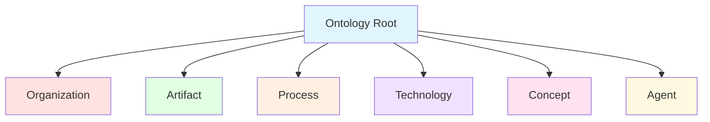

## 2. Organization Hierarchy

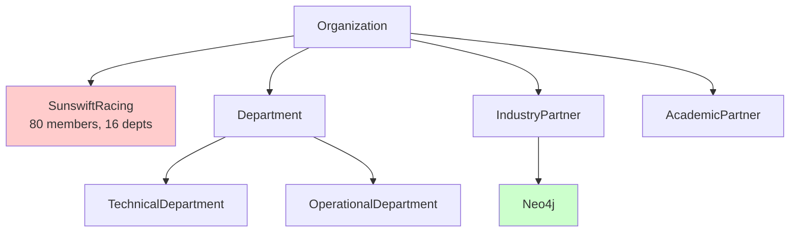

## 3. Artifact Hierarchy (Detailed)

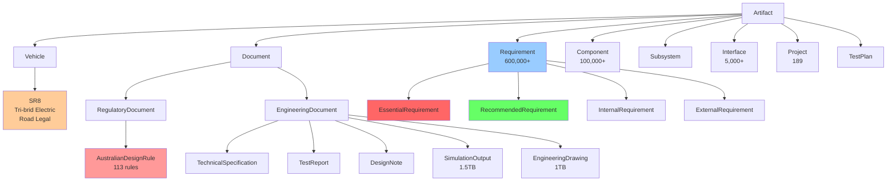

## 4. Process Hierarchy

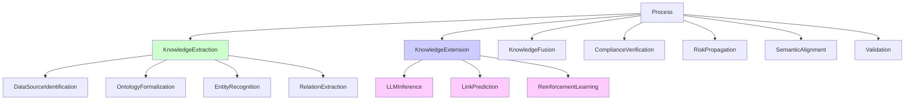

## 5. Technology Stack

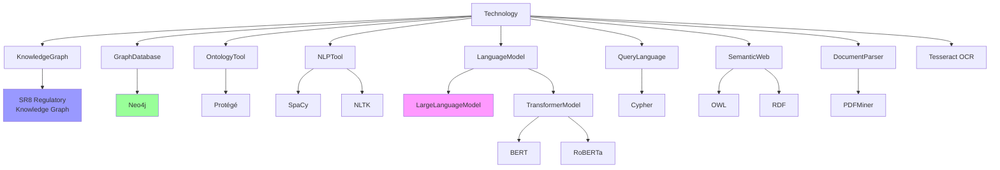

## 6. Concept Map

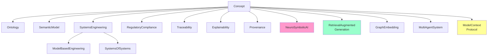

## 7. Multi-Agent System

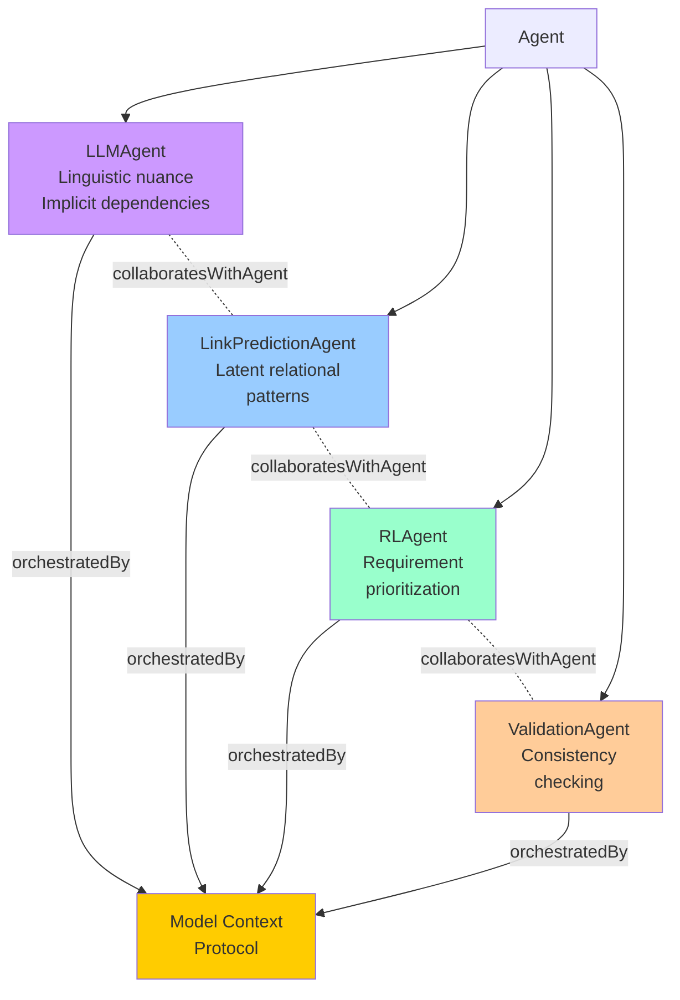

## 8. Key Relationships (Object Properties)

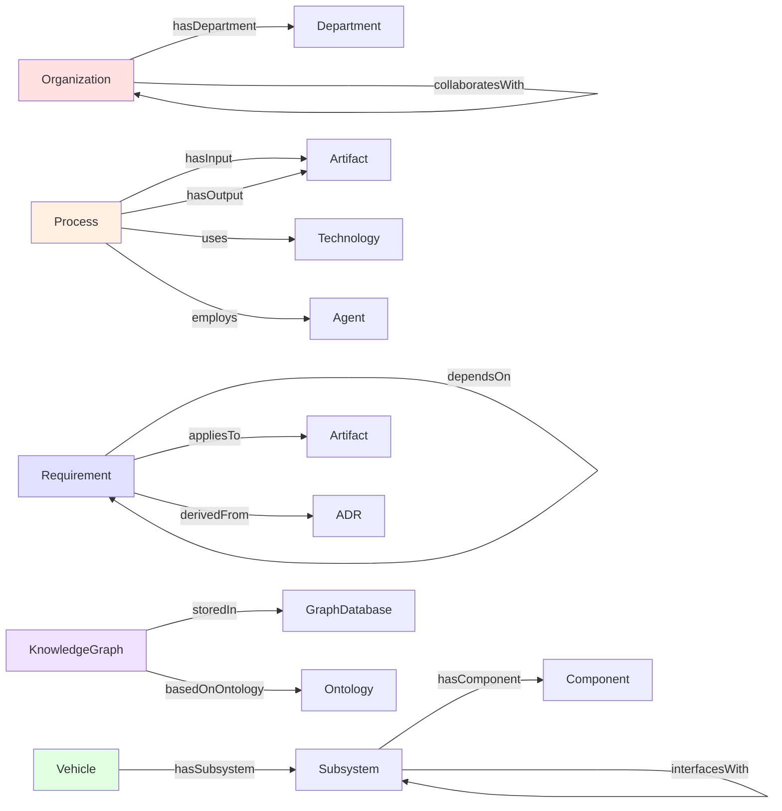

## 9. Complete Workflow Architecture

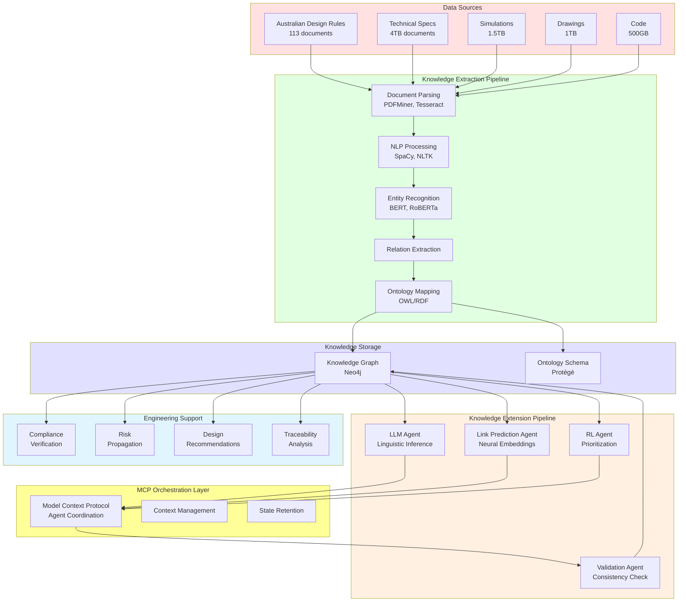

## 10. Requirement Classification System

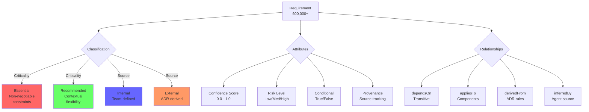

## 11. SR8 Systems Architecture

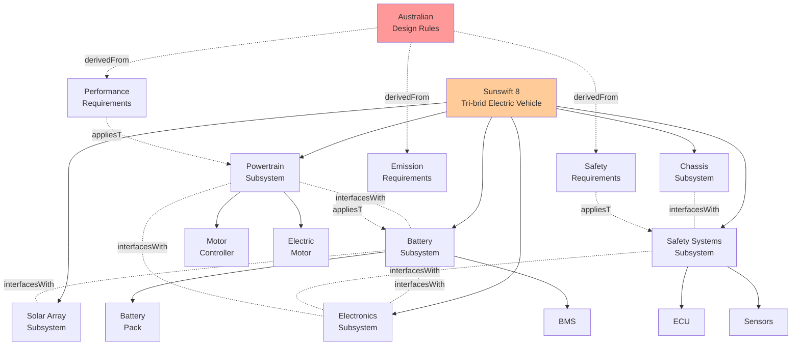

## 12. Data Properties Overview

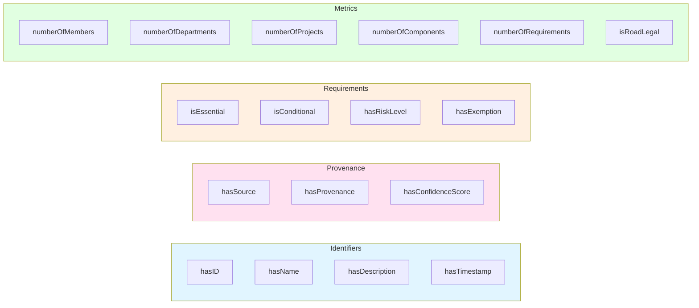

## 13. Ontology Usage in Neo4j

```cypher
// Example: Create SR8 vehicle node
CREATE (sr8:SR8 {
    hasID: "SR8-001",
    hasName: "Sunswift 8",
    hasDescription: "World's first road-legal student-built tri-brid electric vehicle",
    isRoadLegal: true,
    numberOfComponents: 100000,
    numberOfRequirements: 600000
})

// Example: Create ADR and requirement relationship
CREATE (adr:AustralianDesignRule {hasID: "ADR-42", hasName: "General Safety"})
CREATE (req:EssentialRequirement {
    hasID: "REQ-42-001",
    hasDescription: "Crash worthiness standards",
    isEssential: true,
    hasConfidenceScore: 0.95,
    hasRiskLevel: "High"
})
CREATE (req)-[:derivedFrom]->(adr)
CREATE (req)-[:appliesTo]->(sr8)

// Example: Multi-agent inference
CREATE (llm:LLMAgent {hasName: "LLM Inference Agent"})
CREATE (mcp:ModelContextProtocol {hasName: "MCP Orchestrator"})
CREATE (llm)-[:orchestratedBy]->(mcp)
CREATE (req)-[:inferredBy]->(llm)
```

## 14. Semantic Integration

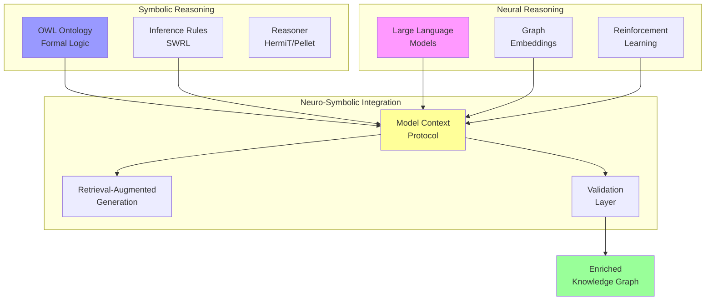

---

## Visualization Tools

To visualize this ontology:

1. **Protégé**: Open `project-ontology.owl` for interactive exploration
2. **Neo4j Browser**: Import and visualize graph relationships
3. **Mermaid**: Render these diagrams in Markdown viewers
4. **GraphViz**: Export from Protégé as DOT format
5. **WebVOWL**: Online ontology visualization at http://vowl.visualdataweb.org/webvowl.html

---

*These diagrams provide a comprehensive visual representation of the SR8 thesis ontology, showing the hierarchical structure, relationships, workflows, and integration points across the entire knowledge framework.*
