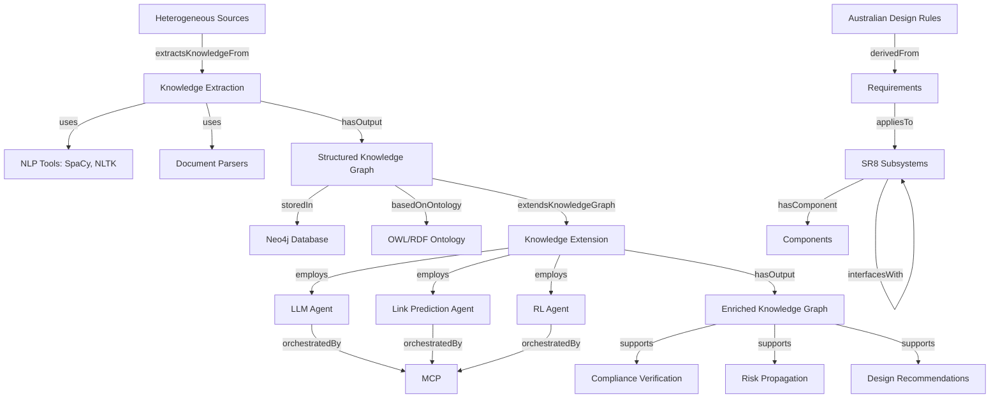

# SR8 Thesis Ontology Documentation

## Overview
This ontology formally represents the knowledge domain of the Sunswift Racing SR8 systems engineering framework, integrating regulatory compliance, knowledge graph technologies, and AI-assisted reasoning.

**URI**: `http://www.sunswift.com/ontology/sr8-thesis`  
**Version**: 1.0  
**Created**: February 26, 2026  
**Authors**: Manan Rathi, Ilina Sharma

---

## Top-Level Taxonomy

The ontology is organized into six main class hierarchies:

```
1. Organization      - Entities involved in the SR8 project
2. Artifact          - Engineering artifacts, documents, and knowledge items
3. Process           - Methodological processes and workflows
4. Technology        - Technical tools, frameworks, and systems
5. Concept           - Theoretical and methodological concepts
6. Agent             - Computational agents in the multi-agent system
```

---

## Class Hierarchies

### 1. Organization Hierarchy

```
Organization
├── SunswiftRacing
│   └── [80 members, 16 departments, 189 projects]
├── Department
│   ├── TechnicalDepartment
│   └── OperationalDepartment
├── IndustryPartner
│   └── Neo4j
└── AcademicPartner
```

**Key Relationships**:
- `hasDepartment`: Links Sunswift to its departments
- `collaboratesWith`: Inter-organizational collaboration

---

### 2. Artifact Hierarchy

```
Artifact
├── Vehicle
│   └── SR8 (Sunswift 8)
│       └── [100,000+ components, road-legal tri-brid electric]
├── Document
│   ├── RegulatoryDocument
│   │   └── AustralianDesignRule (ADR)
│   │       └── [113 rules governing vehicle compliance]
│   └── EngineeringDocument
│       ├── TechnicalSpecification
│       ├── TestReport
│       ├── DesignNote
│       ├── SimulationOutput
│       └── EngineeringDrawing
├── Requirement (600,000+)
│   ├── EssentialRequirement (non-negotiable constraints)
│   ├── RecommendedRequirement (contextual flexibility)
│   ├── InternalRequirement
│   └── ExternalRequirement
├── Component (100,000+)
├── Subsystem
├── Interface (5,000+ interactions)
├── Project (189 concurrent)
└── TestPlan
```

**Key Relationships**:
- `hasRequirement`: Artifacts have associated requirements
- `hasSubsystem`: Vehicle decomposition
- `hasComponent`: Subsystem composition
- `interfacesWith`: Cross-subsystem interactions (symmetric)
- `dependsOn`: Requirement dependencies (transitive)
- `appliesTo`: Requirement-artifact mapping
- `derivedFrom`: Requirements sourced from ADRs
- `documentedIn`: Documentation references

---

### 3. Process Hierarchy

```
Process
├── KnowledgeExtraction
│   ├── DataSourceIdentification
│   ├── OntologyFormalization
│   ├── EntityRecognition
│   └── RelationExtraction
├── KnowledgeExtension
│   ├── LLMInference (LLM-supported inference)
│   ├── LinkPrediction (neural link prediction)
│   └── ReinforcementLearning (RL-based prioritization)
├── KnowledgeFusion
├── ComplianceVerification
├── RiskPropagation
├── SemanticAlignment
└── Validation
```

**Key Workflow**:
```
DataSources → Extraction → Fusion → Extension → Validation → Recommendation
```

**Key Relationships**:
- `hasInput`: Process inputs
- `hasOutput`: Process outputs
- `uses`: Technology employed
- `employs`: Agents used
- `precedesProcess`: Sequential dependencies
- `extractsKnowledgeFrom`: Document processing
- `extendsKnowledgeGraph`: Graph enrichment

---

### 4. Technology Hierarchy

```
Technology
├── KnowledgeGraph
│   └── SR8 Regulatory Knowledge Graph
├── GraphDatabase
│   └── Neo4j
├── OntologyTool
│   └── Protégé
├── NLPTool
│   ├── SpaCy
│   └── NLTK
├── LanguageModel
│   ├── LargeLanguageModel (LLM)
│   └── TransformerModel
│       ├── BERT
│       └── RoBERTa
├── QueryLanguage
│   └── Cypher
├── SemanticWeb
│   ├── OWL (Web Ontology Language)
│   └── RDF (Resource Description Framework)
├── DocumentParser
│   └── PDFMiner
└── Tesseract (OCR)
```

**Key Relationships**:
- `representsKnowledge`: KG representation scope
- `storedIn`: Storage technology
- `queriedBy`: Query mechanisms
- `basedOnOntology`: Semantic foundation

---

### 5. Concept Hierarchy

```
Concept
├── Ontology (formal knowledge representation)
├── SemanticModel
├── SystemsEngineering
│   ├── ModelBasedEngineering
│   └── SystemsOfSystems
├── RegulatoryCompliance
├── Traceability
├── Explainability
├── Provenance (knowledge origin and history)
├── NeuroSymbolicAI (neural + symbolic reasoning)
├── RetrievalAugmentedGeneration (RAG)
├── GraphEmbedding
├── MultiAgentSystem
└── ModelContextProtocol (MCP)
    └── [Orchestration layer for multi-agent workflows]
```

---

### 6. Agent Hierarchy

```
Agent
├── LLMAgent (LLM Inference Agent)
│   └── [Linguistic nuance and contextual reasoning]
├── LinkPredictionAgent
│   └── [Detects latent relational patterns]
├── RLAgent (Reinforcement Learning Agent)
│   └── [Requirement prioritization and classification]
└── ValidationAgent
    └── [Consistency checking and ontology alignment]
```

**Orchestration**: All agents coordinated by Model Context Protocol (MCP)

**Key Relationships**:
- `orchestratedBy`: MCP coordination
- `collaboratesWithAgent`: Inter-agent communication (symmetric)
- `inferredBy`: Agent-generated inferences

---

## Key Object Properties (Relationships)

### Organizational
- `hasDepartment`: Organization → Department
- `collaboratesWith`: Organization ↔ Organization

### Artifact Relations
- `hasRequirement`: Artifact → Requirement
- `hasComponent`: Subsystem → Component (transitive)
- `hasSubsystem`: Vehicle → Subsystem
- `interfacesWith`: Subsystem ↔ Subsystem (symmetric)
- `dependsOn`: Requirement → Requirement (transitive)
- `appliesTo`: Requirement → Artifact
- `derivedFrom`: Requirement → ADR
- `documentedIn`: Artifact → Document

### Process Relations
- `hasInput` / `isInputTo`: Process ↔ Artifact (inverse)
- `hasOutput`: Process → Artifact
- `uses`: Process → Technology
- `employs`: Process → Agent
- `precedesProcess`: Process → Process
- `extractsKnowledgeFrom`: KnowledgeExtraction → Document
- `extendsKnowledgeGraph`: KnowledgeExtension → KnowledgeGraph

### Technology Relations
- `representsKnowledge`: KnowledgeGraph → Artifact
- `storedIn`: KnowledgeGraph → GraphDatabase
- `queriedBy`: GraphDatabase → QueryLanguage
- `basedOnOntology`: KnowledgeGraph → Ontology

### Agent Relations
- `orchestratedBy`: Agent → ModelContextProtocol
- `collaboratesWithAgent`: Agent ↔ Agent (symmetric)
- `inferredBy`: Requirement → Agent

### Compliance & Risk
- `compliesWith`: Artifact → AustralianDesignRule
- `hasRisk`: Artifact → Requirement
- `propagatesRiskTo`: Subsystem → Subsystem

---

## Data Properties (Attributes)

### Identifiers & Metadata
- `hasID`: Unique identifier (string)
- `hasName`: Entity name (string)
- `hasDescription`: Detailed description (string)
- `hasTimestamp`: Temporal metadata (dateTime)

### Provenance & Confidence
- `hasSource`: Data source (string)
- `hasProvenance`: Origin and history (string)
- `hasConfidenceScore`: Extraction confidence (float, 0-1)

### Requirement Attributes
- `isEssential`: Essential vs. recommended (boolean)
- `isConditional`: Conditional applicability (boolean)
- `hasRiskLevel`: Risk categorization (string)
- `hasExemption`: ADR exemption details (string)

### Quantitative Metrics
- `numberOfMembers`: Team size (integer)
- `numberOfDepartments`: Organizational units (integer)
- `numberOfProjects`: Concurrent projects (integer)
- `numberOfComponents`: Component count (integer)
- `numberOfRequirements`: Requirement count (integer)
- `isRoadLegal`: Legal status (boolean)

---

## Axioms & Constraints

### Disjoint Classes
- `EssentialRequirement` ⊥ `RecommendedRequirement`
- `InternalRequirement` ⊥ `ExternalRequirement`
- `KnowledgeExtraction` ⊥ `KnowledgeExtension`

### Property Characteristics
- **Symmetric**: `interfacesWith`, `collaboratesWithAgent`, `collaboratesWith`
- **Transitive**: `dependsOn`, `hasComponent`
- **Inverse**: `hasInput` ↔ `isInputTo`

---

## Complete Workflow Integration



---

## Quantitative Context

Based on the SR8 project scale:

| Metric | Value | Ontology Class |
|--------|-------|----------------|
| Team Members | 80 | Organization |
| Departments | 16 | Department |
| Projects | 189 | Project |
| Interfaces | 5,000+ | Interface |
| Components | 100,000+ | Component |
| ADR Rules | 113 | AustralianDesignRule |
| Requirements | 600,000+ | Requirement |
| Documents | 4 TB | Document |
| Simulations | 1.5 TB | SimulationOutput |
| Drawings | 1 TB | EngineeringDrawing |
| Code | 500 GB | Artifact |

---

## Usage Examples

### Example 1: Querying Requirement Dependencies
```cypher
MATCH (r1:Requirement)-[:dependsOn*]->(r2:Requirement)
WHERE r1.hasID = "ADR-42-3.1"
RETURN r1, r2
```

### Example 2: Finding Risk Propagation Paths
```cypher
MATCH path = (s1:Subsystem)-[:propagatesRiskTo*]->(s2:Subsystem)
WHERE s1.hasName = "Battery System"
RETURN path
```

### Example 3: Identifying Non-Compliant Components
```cypher
MATCH (c:Component)-[:appliesTo]-(r:Requirement)
WHERE NOT (c)-[:compliesWith]->(:AustralianDesignRule)
RETURN c.hasName, r.hasDescription
```

### Example 4: Tracing Agent Inferences
```cypher
MATCH (req:Requirement)-[:inferredBy]->(agent:Agent)
WHERE req.hasConfidenceScore < 0.8
RETURN req, agent, req.hasProvenance
```

---

## Integration with Thesis Structure

### Manan's Focus (Knowledge Extraction)
- **Ontology Classes**: `OntologyFormalization`, `EntityRecognition`, `RelationExtraction`
- **Technologies**: `OWL`, `RDF`, `Protégé`, `Neo4j`, `Cypher`
- **Processes**: `KnowledgeExtraction`, `SemanticAlignment`, `Validation`

### Ilina's Focus (Knowledge Extension)
- **Ontology Classes**: `LLMInference`, `LinkPrediction`, `ReinforcementLearning`
- **Agents**: `LLMAgent`, `LinkPredictionAgent`, `RLAgent`
- **Concepts**: `ModelContextProtocol`, `NeuroSymbolicAI`, `MultiAgentSystem`

### Shared Components
- **Core Domain**: `AustralianDesignRule`, `SR8`, `Requirement`, `Subsystem`
- **Processes**: `ComplianceVerification`, `RiskPropagation`
- **Collaboration**: `SunswiftRacing`, `Neo4jPartner`, `AcademicPartner`

---

## Ontology Files

1. **project-ontology.owl** - Machine-readable OWL/RDF format
   - Can be opened in Protégé for visualization
   - Can be imported into Neo4j for graph instantiation
   - Supports SPARQL and reasoning queries

2. **ontology-documentation.md** - Human-readable documentation (this file)

---

## Next Steps

### For Development
1. Import ontology into Protégé for visual editing
2. Validate logical consistency using HermiT or Pellet reasoner
3. Generate Neo4j schema from OWL classes and properties
4. Populate graph with SR8 project data
5. Implement MCP orchestration layer

### For Thesis
1. Reference ontology in methodology section
2. Include class diagrams in appendix
3. Cite as formal knowledge representation framework
4. Use for traceability and provenance demonstration

---

## References to Thesis Sections

- **Abstract**: Lines 1-11 (Ontology-driven framework overview)
- **Introduction**: Knowledge representation and semantic models
- **Context**: SR8 project metrics (80 members, 600K requirements)
- **Methodology - Section 5.1**: Knowledge Extraction processes
- **Methodology - Section 5.2**: Knowledge Extension and multi-agent system
- **Methodology - Section 5.3**: Systems of Systems integration
- **Collaboration**: Industry (Neo4j) and academic partnerships

---

*This ontology serves as the semantic backbone for the entire SR8 systems engineering framework, enabling explainable, traceable, and adaptive regulatory compliance through the integration of structured knowledge representation and AI-assisted reasoning.*
